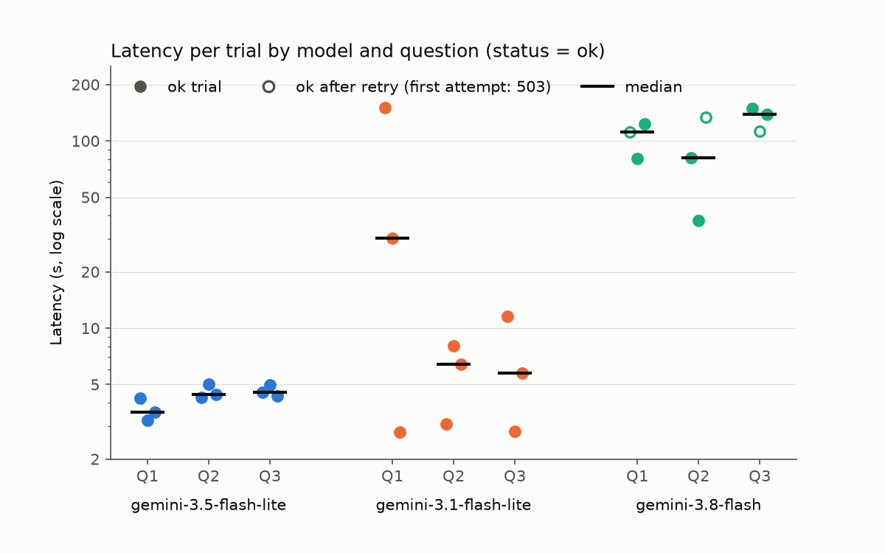
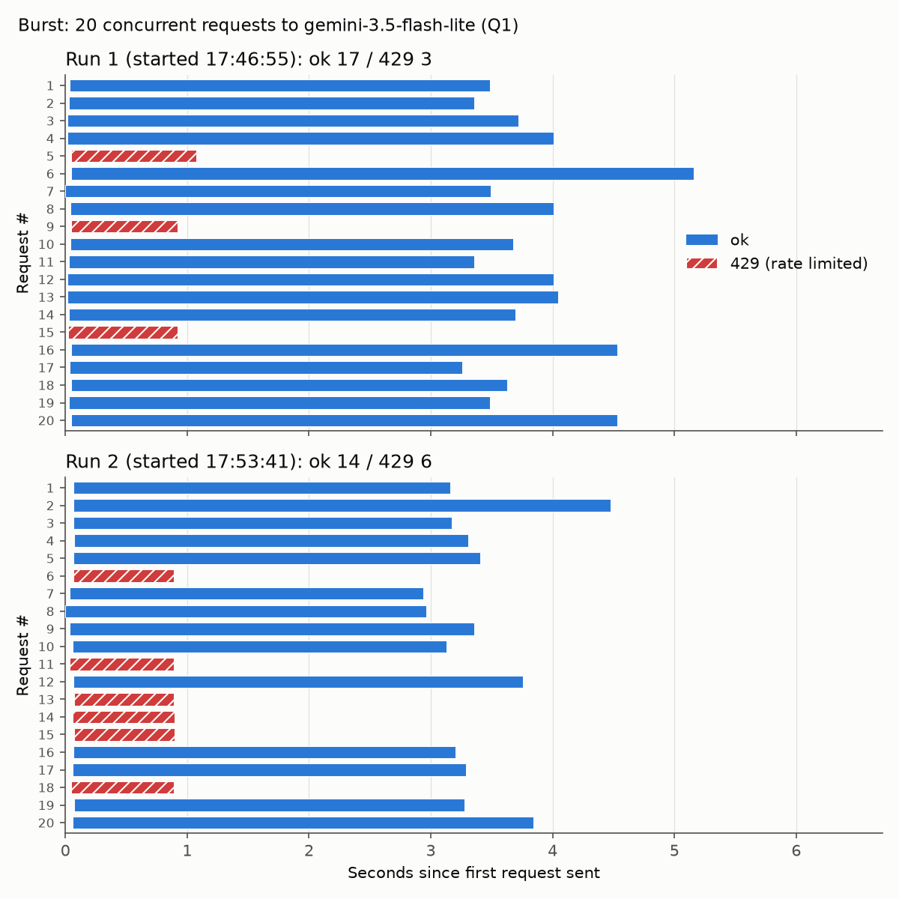
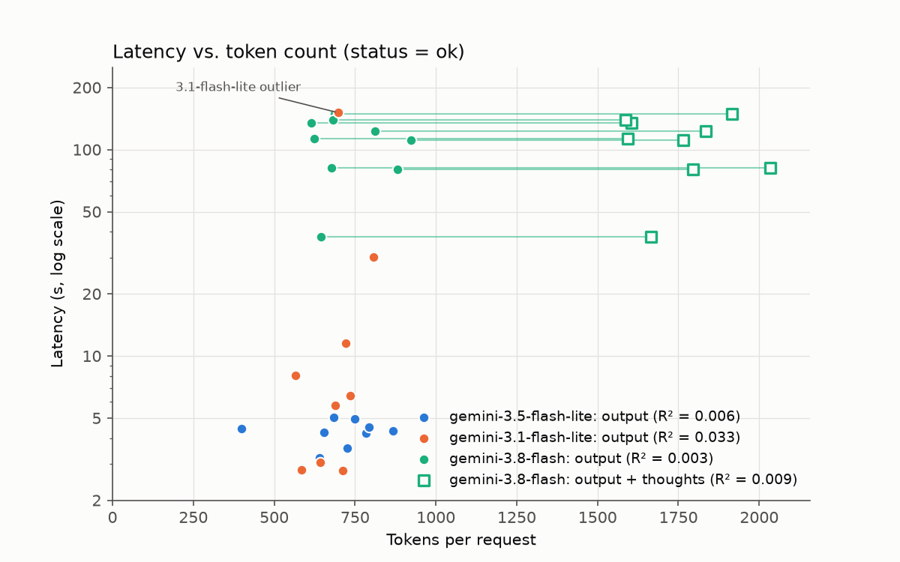
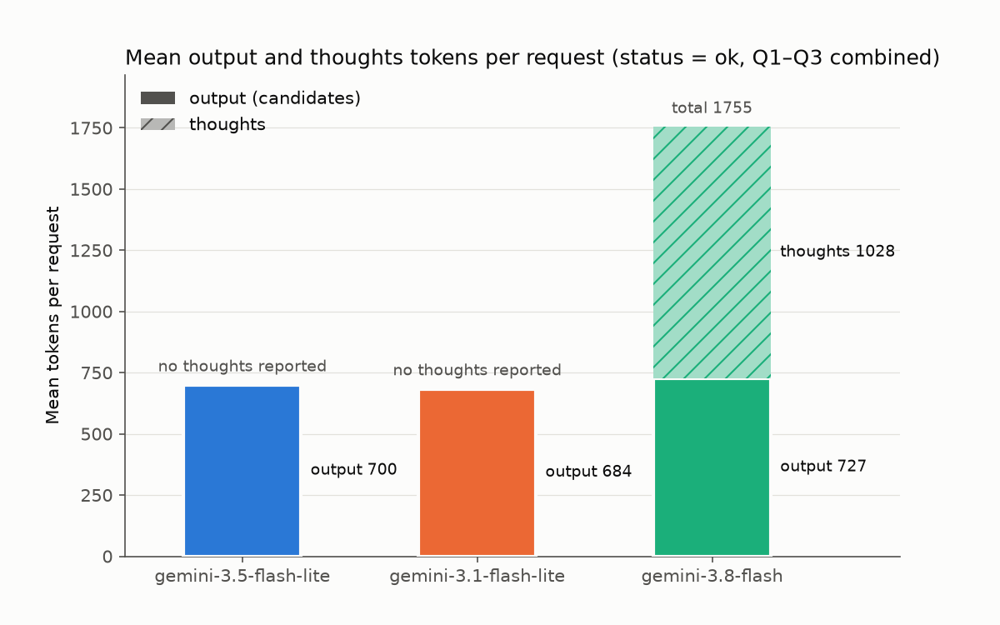

# 第1回 解答

## 演習

- 講座に固有の質問（宿題の3レベル）へのモデルの回答（要約でよい）：
  同じモデル（gemini-3.5-flash-lite）に同じ質問を2回した。
  - 1回目（Codespaces）：講座の情報を持っていないことには触れず、「レベル1 基礎・入門 / レベル2 応用・実践 / レベル3 発展・挑戦」という一般的な3段階を、「一般的にはこう構成される」という形で答えた。
  - 2回目（ローカル、2026-10-25）：最初に「AIE2026 の情報は持っていない」と断ったうえで、「スキルの難易度」「AI の活用段階」「思考の深さ」という3通りの推測を並べ、講座の FAQ や講師に確認するよう勧めた。
- 用語集の正しい意味と比べて気づいたこと：
  - 正しくは「基礎（講義内容の確認）・実装（自分でコードを書く）・発展（調査や試行）の3段階で、どれか1つに取り組めばその回の宿題は完了。原則として採点はしない」。
  - 2回とも中身は外れている。1回目は「基礎」「発展」という名前が偶然重なっているが、「実装＝自分でコードを書く」ことや「どれか1つで完了」という構成の要点は、どちらの回答にも出てこない。
  - 同じ質問でも、知らないと認める回と、一般論をもっともらしく答える回があった。回答の中身だけでなく、答え方そのものが実行ごとに揺れる。
- 表示できたトークン数（入力 / 出力）：
  - 一般的な質問「LoRA とは何ですか？」：7 / 482
  - 講座に固有の質問「AIE2026の講座の宿題にある『3レベル』とは何ですか？」：21 / 634
  - 入力は数十トークンでも、出力は数百トークンになる。応答時間や（有料枠での）費用は、出力側で決まる部分が大きい。

## 宿題

- 取り組んだレベル：発展

- 目的：
  - **何をしたかったか**：LLM の API を呼んだときの応答時間が何で決まるのかを測り、あわせて無料枠のレート制限が実際にどう効くのかを確かめる。
  - **何のためか**：この講座では、このあとエージェント（第3回以降）を作る。エージェントは1つの質問で LLM を何度も呼ぶので、1回あたりの応答時間とレート制限が、そのまま使い勝手と実験の進めやすさを左右する。モデルの選び方や、呼び出しの回数・間隔を決めるための根拠を、自分で測って得ておきたい。
  - **確かめたい問い**：
    1. モデルによって、応答時間はどれくらい違うか。
    2. 応答時間は、生成するトークン数（思考トークンを含む）で説明できるか。仮説は「応答時間 ≈ 固定のオーバーヘッド + トークン数 × 1トークンあたりの生成時間」。
    3. 無料枠の RPM の上限を超えて同時に送ると、レート制限はどう効くか。

- やったこと：
  - 計測スクリプト `scripts/measure_latency.py` を作成した（標準ライブラリだけで集計し、依存パッケージは追加していない）。実装には Claude Code を使い、計画・結果・集計は自分で確認した。
  - **実験A（モデル × 質問。問い1・2）**：3モデル × 3質問 × 3回 = 27試行。
    - モデル：gemini-3.5-flash-lite / gemini-3.1-flash-lite / gemini-3.8-flash
    - 質問：Q1「LoRA とは何ですか？」/ Q2 講座に固有の質問（3レベル）/ Q3「Transformer の仕組みを初学者向けに1000字程度で説明してください。」
    - 応答時間（`time.perf_counter`）と、入力・出力・思考トークン数を記録した。
  - **実験B（レート制限の観測。問い3）**：gemini-3.5-flash-lite に Q1 を20本同時に送った（`ThreadPoolExecutor`）。約6.5分あけて2回実行した。
  - **無料枠から逆算した計画**：AI Studio で上限を確認し（3.5-flash-lite と 3.1-flash-lite は 15 RPM / 1日500回、3.8-flash は 5 RPM / 1日20回）、回数と送信間隔を決めた。
    - 送信間隔は RPM の上限に 1.2 倍の余裕をとった（lite は5秒、3.8-flash は15秒）。
    - 429 / 503 のときは待ってから1回だけやり直し、失敗した試行も1行として記録した。集計は成功した行だけで行い、全条件で n=3 を確保した。
    - 3.8-flash は1日20回の上限のうち12回を使った（9試行 + やり直し3回）。
  - 元データと集計：`lectures/01/results/`（`raw_*.csv`、`summary.md`）。
  - 開発環境は Codespaces ではなく、ローカルの Mac（uv で Python 3.12 の環境を構築）。

- 結果：

  問いへの答えを先にまとめる（詳細は下の表と図、考察は「気づき・疑問」）。

  1. **モデルの差**：3.5-flash-lite は 3〜5 秒で安定、3.1-flash-lite は 2.8〜151 秒と大きくばらつき、3.8-flash は 38〜149 秒と1桁以上遅かった（図1）。
  2. **トークン数で説明できるか**：できなかった。どのモデルでも R² < 0.04 で、思考トークンを含めても同じだった（図2、図3）。
  3. **レート制限**：15 RPM に対して20本同時に送ると、通ったのは17件と14件。429 は約1秒で返り、どのリクエストが拒否されるかは送った順と関係がなかった（図4）。

  **実験A**（問い1・2。応答時間は秒。外れ値も除外していない）

  | モデル | 応答時間の範囲 | 質問ごとの中央値（Q1 / Q2 / Q3） | 出力トークン | 思考トークン | 出力の速さ |
  |---|---|---|---|---|---|
  | gemini-3.5-flash-lite | 3.2〜5.0 | 3.6 / 4.4 / 4.5 | 400〜867 | なし | 126〜197 トークン/秒 |
  | gemini-3.1-flash-lite | 2.8〜150.9 | 30.1 / 6.4 / 5.8 | 566〜807 | なし | 不安定 |
  | gemini-3.8-flash | 37.6〜149.0 | 111.3 / 81.6 / 138.7 | 615〜923 | 841〜1357 | 5〜10 トークン/秒（思考を除く） |

  

  図1：モデル × 質問ごとの応答時間（各点が1試行、横線は中央値、縦軸は対数）。3.5-flash-lite は 3〜5 秒に固まり、3.1-flash-lite は 2.8〜151 秒と大きくばらつき、3.8-flash は 38〜149 秒と1桁以上遅い。白抜きは 503 のあとやり直して成功した試行。

  - 3.8-flash では 503 が3回出たが、20秒待ってのやり直しで3回とも成功した。
  - 応答時間を出力トークン数で直線に当てはめると（latency = a + b × トークン数）、どのモデルでも R² < 0.04 で、ほとんど説明できなかった。3.8-flash は、出力 + 思考トークンで当てはめても同じだった。

  **実験B**（問い3。15 RPM の上限に対して20本同時）

  | | 通った（ok） | 429 | 429 になった番号 | 429 が返るまで | ok の応答時間（中央値） |
  |---|---|---|---|---|---|
  | 1回目 | 17 | 3 | 5, 9, 15 | 0.87〜1.03 秒 | 3.67 秒 |
  | 2回目 | 14 | 6 | 6, 11, 13, 14, 15, 18 | 0.82〜0.86 秒 | 3.21 秒 |

  

  図4：20本同時送信の様子（横棒は送信から完了まで）。2回とも20本はほぼ同時に送られ、429（赤）は約 0.9 秒で返った。429 になったリクエストの番号は2回で重なっておらず（共通は15番だけ）、送った順とは関係がない。

- 気づき・疑問：
  1. **応答時間はトークン数ではほとんど説明できなかった。** 原因は2つあると考える。
     - 出力が全質問で 600〜900 トークン前後に集まり、x の幅が狭かった。Q3 で「1000字程度」と頼んでも出力はほかの質問とあまり変わらず、プロンプトでの長さの指示はほぼ効かなかった。
     - 3.8-flash では、トークン数がほぼ同じでも応答時間が 37.6 秒から 149 秒まで約4倍ばらついた。同じ時間帯に 503 も出ていたので、生成量よりもサーバー側の待ち（混雑）が支配的だったと考える。3.1-flash-lite も、2.8 秒で返る回と 30〜150 秒かかる回が混ざっていた。

     

     図2：応答時間とトークン数（縦軸は対数）。lite の出力トークンは 400〜900 の狭い範囲に集まっている。3.8-flash は思考トークンを加える（□）と右へ大きくずれるが、応答時間とはやはり関係が見えない（R² はすべて 0.04 未満）。
  2. **上位モデルの思考トークンは「見えない出力」。** 3.8-flash は出力の1.0〜1.7倍の思考トークンを使っていた。回答には現れないが、待ち時間に効き、有料枠なら課金対象にもなる。

     

     図3：1リクエストあたりのトークンの内訳（平均）。出力は3モデルとも約 700 で同じだが、3.8-flash だけ思考トークンが平均 1028 加わり、合計は lite の約2.5倍になる。
  3. **レート制限は上限ちょうどで切られるわけではない。** 20本同時に送ると、通ったのは17件と14件（平均15.5件）で、15 RPM のまわりでばらついた。429 になるリクエストは送った順と関係なく、約1秒で即座に返った。通ったリクエストの応答時間は順次送信とほぼ同じで、拒否は受け付けの時点で判断されていると考える。実際に使うときは、クライアント側で送る数を絞ることと、429 が返ったら待ってやり直す仕組みの両方が必要になる。順番に送るだけのループでも、応答が約3秒なら毎分約18回になり、上限を超えうる。
  4. **上位モデルでの実験は、回数と時間の両方が制約になる。** 3.8-flash は1日20回の上限に加えて1回100秒前後かかり、見積もり約4分の実験Aが実際には約20分かかった。
  5. **限界と、次にやるなら。** 各条件 n=3 で、1つの時間帯に1回しか測っていないので、モデルの差と混雑の影響を切り分けられていない。次にやるなら、
     - `max_output_tokens` で出力の長さを 50 / 200 / 800 / 2000 トークンのように強制的に振り、1トークンあたりの時間を推定する
     - 時間帯を変えて繰り返す
     - ストリーミングで、最初のトークンが返るまでの時間と、その後の生成速度を分けて測る
  - 疑問：思考トークンの量を設定で制限できるなら、応答時間と回答の質はどう変わるか。
