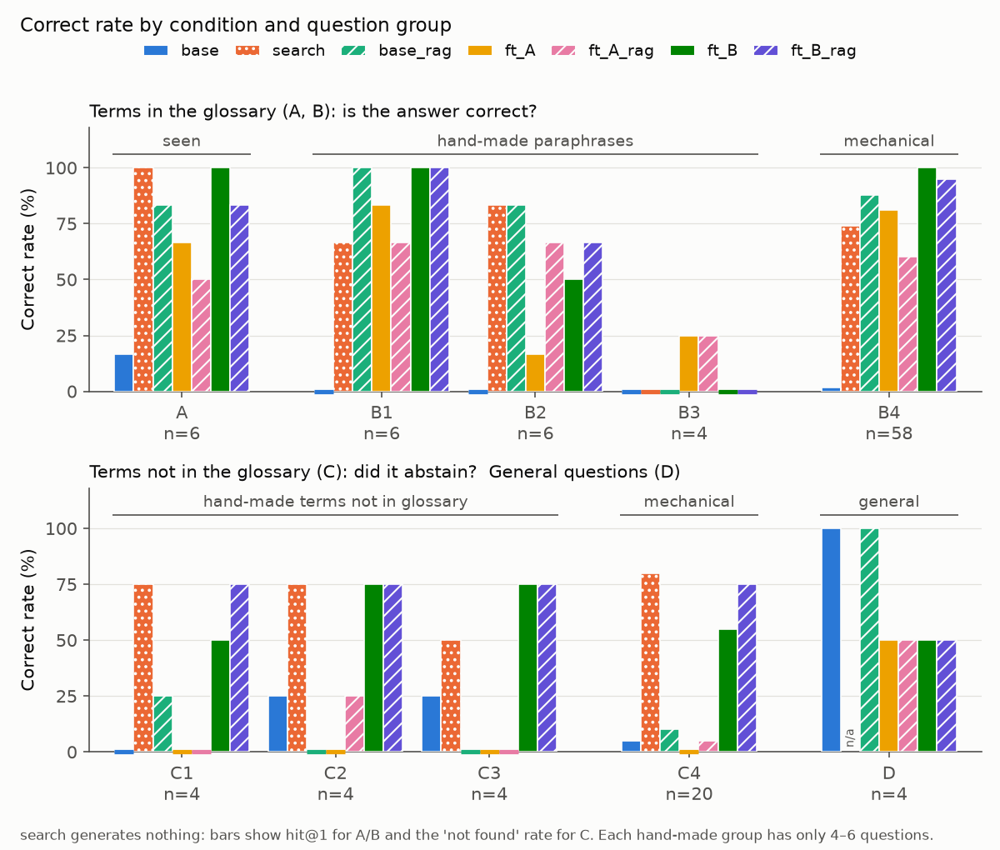
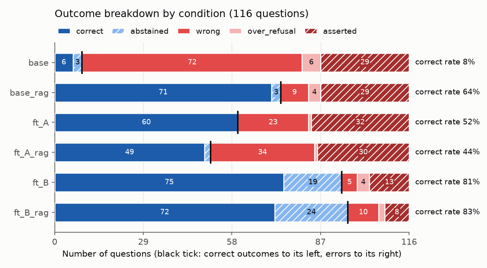

# 第2回 解答

## 演習

架空の講座 FAQ（5 項目）と質問を入力し、`{"answer": 文字列, "needs_review": 真偽値}` の JSON 1 行で答えさせる課題。FAQ に無い質問（根拠なしの質問）には `needs_review: true` で「確認が必要」と答えるのが正解。評価は 21 問（根拠あり 15、根拠なし 6）で、`format_rate` は JSON の形式（キーと型）を守れた割合、`content_rate` は `needs_review` と答えの語句が正解と合った割合。

- 使ったモデル・設定（`result.json` の `config` から）：`Qwen/Qwen3.5-0.8B`（revision `2fc0636…`）、LoRA（量子化なし、r=16、α=32、学習率 2e-4、20 エポック＝40 ステップ、seed 42）、貪欲生成（最大 96 トークン）。ノートブックの設定は変えず、Colab の G4（NVIDIA RTX PRO 6000 Blackwell）で実行した。結果は [result.json](result.json)、[eval_before.json](eval_before.json)、[eval_after.json](eval_after.json)
- 自分で学習を実行したか（`executed_training_myself`）：はい（学習 21 秒。Training Loss は 10 ステップ目 1.57 → 40 ステップ目 0.014）
- 学習前：`format_rate` = 0.095（2/21）/ `content_rate` = 0.0（0/21）
- 学習後：`format_rate` = 1.0（21/21）/ `content_rate` = 0.905（19/21）
- 退行した質問（学習前は正解で、学習後に不正解）：なし
- 学習後に残った失敗と、その型：2 問とも「根拠なしの質問に、FAQ の別の項目を当てて断定した」型
  - 「成績はいつ出ますか」→ 提出形式の文、`needs_review: false`
  - 「オフィスアワーは事前予約が必要ですか」→ オフィスアワーの文、`needs_review: false`
  - 学習前の失敗は形式の崩れで、21 問中 19 問で `needs_review` のキーが欠けていた
- 知識を問う質問（セクション 6）の結果（学習前の分類 → 学習後の分類）と気づいたこと：
  - 最終課題の締切：format_error → **asserted**（FAQ の「課題の提出期限」の文で断定）
  - 担当教員の名前：format_error → needs_review
  - 次回の講義のテーマ：format_error → needs_review
  - 対照（FAQ にある「課題の提出期限」）：format_error → asserted（正しい）
  - 断定したのは、FAQ と語（課題・締切）が重なる質問だった。確認を求めたのは、語が重ならない 2 問だった。根拠の有無ではなく、語の重なりで判断しているように見える
- 学習で変わったこと・変わらなかったこと：形式（JSON・キー・型）は 21 問すべてで守れるようになった。FAQ に根拠があるかの判断は変わらず、FAQ と語が重なる根拠なしの質問では断定が残った
- 補足
  - セクション 8：4bit で読み込むと、重みのメモリは 3.01 GB → 0.76 GB になった。学習しないまま `format_rate` 0.095 → 0.619、`content_rate` 0.0 → 0.333 に変わったが、根拠なしの 6 問はすべて誤りのままだった
  - 講師の参考結果（T4）との比較：学習前の出力は 21 問すべて一字一句同じで、学習後は 21 問中 20 問が同じだった。違った 1 問は、どちらも誤りだった

## 宿題

- 取り組んだレベル：**発展**
- 変えた設定やデータ：下の表。モデル、revision、LoRA の設定（r=16、α=32、学習率 2e-4、対象の層）、seed、貪欲生成は演習と同じ

  | 項目 | 演習 | 宿題 |
  |---|---|---|
  | 学習データ | 架空 FAQ の手本 14 件 | 講座の用語集（58 語）から作った手本。A 版 116 件（配布スクリプトのまま）、B 版 510 件（改良版） |
  | エポック | 20（40 ステップ） | A 版 10（150 ステップ）、B 版 3（192 ステップ） |
  | 答えの形 | JSON 1 行 | 用語集の定義文、または「その用語は用語集にありません。」 |
  | 生成の最大トークン | 96 | 192（定義文が最長 95 トークンのため） |
  | 評価 | 21 問（配布） | 116 問（自作） |
  | 精度 | ノートブックの既定 | 32bit（fp32）を明示 |

- 結果：「結果」の節
- ファインチューニングが向く場面・向かない場面についての考察：「考察」の節

### 目的

用語集の知識を、モデルに**学習させる**場合と、**検索して入力に渡す**場合とで、何ができて何ができないかを、同じモデル・同じ質問で比べる。確かめたい問いは次の 4 つ。

1. 学習で用語の定義が身につくか。学習で見ていない聞き方（言い換え・別名・名前を出さない説明）でも答えられるか
2. 用語集にない語を聞かれたとき、断れるか
3. 用語集と関係のない普通の質問への答えが、学習で壊れないか
4. 検索する仕組みと比べて、学習させるメリットとデメリットは何か

### やったこと

#### 学習データ

| 版 | 中身 |
|---|---|
| A 版（116 件） | 配布の [make_sft_dataset.py](../../scripts/make_sft_dataset.py) の出力そのまま。58 語 × 2 つの聞き方（「『{用語}』とは何ですか？」など）で、答えは定義文。system プロンプトなし、用語集にない語の手本なし |
| B 版（510 件） | [make_sft_dataset_b.py](../../scripts/make_sft_dataset_b.py) で作った改良版。全件に system プロンプトを入れた。内訳は次の 3 つ。定義の手本：58 語 × 6 つの聞き方＝348 件。別名で聞く手本：102 件（評価で使う 6 つの別名は除外）。用語集にない 30 語に「その用語は用語集にありません。」と答える手本：60 件 |

データはローカル（uv）で作り、Colab ではリポジトリを clone して読み込んだ（資料の「Codespaces で作り、Colab にアップロード」の代わり）。ノートブックは [lec02_glossary_sft.ipynb](../../notebooks/lec02_glossary_sft.ipynb)。

#### 比べた条件

| ラベル | モデル | 入力に検索結果を入れるか |
|---|---|---|
| base | 学習前のモデル | 入れない |
| base_rag | 学習前のモデル | 入れる |
| ft_A | A 版で学習したモデル | 入れない |
| ft_A_rag | A 版で学習したモデル | 入れる |
| ft_B | B 版で学習したモデル | 入れない |
| ft_B_rag | B 版で学習したモデル | 入れる |
| search | （モデルを使わず、検索の当たり方だけを見る） | – |

- 検索には、講座の `app/tools.py` の `search_glossary` を使った。質問文に用語名か別名が含まれるかで探し、最大 3 件の定義を返す。見つからなければ「見つかりませんでした」と返す
- 「検索結果を入れる」は、質問の前に、この返り値を「用語集の検索結果:」として入れること
- system プロンプトは全条件で同じ。用語集にあれば定義を答え、なければ「その用語は用語集にありません。」とだけ答えるよう指示した

#### 評価の質問（116 問、[eval_set.json](homework/eval_set.json)）

区分の記号（A〜D）は、学習データの版（A 版・B 版）とは無関係。

| 区分 | 中身 | 問題数 |
|---|---|---|
| A | 用語集にある語を、学習と同じ聞き方で聞く | 6 |
| B1〜B3 | 用語集にある語を、手作りの言い換えで聞く。B1 新しい聞き方 6、B2 別名 6、B3 名前を出さない説明 4（例：「事前学習済みの重みを固定し、小さな行列だけを学習する手法の名前は？」） | 16 |
| B4 | 用語集にある 58 語すべてを、学習で使っていない聞き方「{用語}という用語の意味を、短く説明してください。」で聞く | 58 |
| C1〜C3 | 用語集にない語（手作り）。実在する一般の語（RAG など）、第 2 回の講義に出たが用語集にない語（継続事前学習など）、架空の語（リバースLoRA など）、各 4 | 12 |
| C4 | 用語集にない語 20 語を、B4 と同じ聞き方で聞く | 20 |
| D | 用語集と関係のない普通の質問（日本の首都、1〜10 の和、「ありがとう」の英訳、Python でリストの長さを調べる関数）。system プロンプトなしで聞く | 4 |

#### 採点

答えを次の 5 つに分類した。

| 分類 | 意味 | 正解か |
|---|---|---|
| correct | 正しく答えた（区分 A・B・D） | ○ |
| abstained | 用語集にない語を断った（区分 C） | ○ |
| wrong | 誤って答えた | × |
| over_refusal | 用語集にある語なのに断った | × |
| asserted | 用語集にない語に、説明を作って断定した | × |

- 「正しく答えた」：定義の中心になる語（必須語句）がすべて入っているか。例えば LoRA なら「固定」と、「小さな行列」か「低ランク」
- 「断った」：「用語集に〜ありません」「用語集にない」「わかりません」などの表現を含むか（正規表現）
- 機械的な判定は、原文を読んで確かめた（[summary.md](results/summary.md) の 8〜10 節）
- 評価の質問と採点の仕組みは、LLM（Claude）で下書きし、自分で確認・修正して確定した。実装と集計は Claude Code に任せ、途中の出力を確かめた

### 結果

#### 結論

**用語集を学習させると、用語名で聞かれたときに定義文を出せるようになった。しかし、それは定義文の暗記で、用語名から離れた聞き方、知らない語の扱い、普通の質問には効かないか、かえって悪くなった。検索は、用語名が質問に入っていれば正しい定義を渡せたが、学習前のモデルは「見つかりませんでした」を受けても断れなかった。最も正解が多かったのは、知識を検索で渡し、学習では「見つからなければ断る」振る舞いを教えた組み合わせ（ft_B_rag、116 問中 96 問）だった。**

問いごとの事実：

1. **定義は、用語名で聞かれれば出せるようになった。名前から離れると出せない。**
   - 区分 B4（58 問）の正解：学習前 1 → ft_A 47 → ft_B 58
   - ft_B が区分 A・B で正解した 73 問の答えは、すべて定義文と一字一句同じだった
   - 区分 B3（名前を出さない、4 問）：どの学習の条件でも 0〜1 問
   - 区分 B2（別名、6 問）：ft_A 1 問、ft_B 3 問（別名の手本あり）、base_rag 5 問
2. **配布データのまま（A 版）学習すると、断れなくなった。断る手本を足すと断れるようになったが、断りすぎも出た。**
   - 区分 C（32 問）で断れた数：学習前 3 → ft_A 0 → ft_B 19
   - ft_A は 32 問すべてで、用語集の定義をつぎはぎした説明を作った（例：RAG に、ハーネスや Pi の説明を混ぜる）
   - ft_B は、用語集にある語の質問を 4 問断った（学習から外した別名 2 つ、名前を出さない質問 2 つ）
   - ft_B が断定した 13 問には、名前の一部が用語集と重なる語が含まれていた（「リバースLoRA」に LoRA の定義をほぼそのまま返した）
3. **普通の質問の答えが壊れた。**
   - 区分 D（4 問）の正解：学習前 4 → 学習後 2（A 版・B 版とも）
   - 原文を読むと、必須語句が入っていても中身が壊れている答えがあり、問題のない答えは学習前 2 問 → ft_A 0 問、ft_B 1 問だった
   - 例：「1 から 10 までの整数の和は？」に、ft_A は「1+2+…+9 = 45」、ft_B は「9 の和です。」と答えた
4. **検索は、用語名が入った質問に強く、名前を出さない質問と、名前の一部が重なる語に弱い。**
   - 用語集にある語の 80 問：1 件目が正しい語 58 問、3 件以内 74 問。ただし区分 B3 は 0/4
   - 用語集にない語の 32 問：8 問で、名前の一部が重なる別の語を返した（「継続事前学習」→ 事前学習 など）
   - 学習前のモデルに検索結果を渡すと（base_rag）、用語集にある語の 80 問中 67 問に正しく答えた。しかし用語集にない語は、32 問中 3 問しか断れなかった
   - B 版で学習したモデルに検索結果を渡すと（ft_B_rag）、断れた数は 24 問に増えた

#### 条件ごとの正解数

| 条件 | 区分 A（6） | B1〜B3（16） | B4（58） | C1〜C3（12） | C4（20） | D（4） | 全体（116） |
|---|---|---|---|---|---|---|---|
| base | 1 | 0 | 1 | 2 | 1 | 4 | 9 |
| search ※ | 6 | 9 | 43 | 8 | 16 | – | 82（112 問中） |
| base_rag | 5 | 11 | 51 | 1 | 2 | 4 | 74 |
| ft_A | 4 | 7 | 47 | 0 | 0 | 2 | 60 |
| ft_A_rag | 3 | 9 | 35 | 1 | 1 | 2 | 51 |
| ft_B | 6 | 9 | 58 | 8 | 11 | 2 | 94 |
| ft_B_rag | 5 | 10 | 55 | 9 | 15 | 2 | **96** |

区分 A・B・D は正しく答えた数、区分 C は断れた数。※ search は答えの文を作らないので、区分 A・B は 1 件目に正しい語が来たか、区分 C は「見つかりませんでした」を返したかで数えた。

*図1：上の表を割合にしたもの。上段は用語集にある語、下段は用語集にない語と普通の質問。学習だけの条件（ft_A・ft_B）は区分 B3 と D で、検索結果を渡した学習前のモデル（base_rag）は区分 C で落ちる。*

*図2：116 問の答えの分類（「採点」の表）。黒い縦線より左が正解。ft_A は断定（asserted）が 32 問で、断れた（abstained）は 0 問。B 版で学習すると断れた数が増え、用語集にある語を断る誤り（over_refusal）も出る。*

#### 数字を読むときの注意

- 区分 B4 は質問に用語名が入るので、ft_B の 58/58 は「名前で聞けば定義を出せる」ことしか示さない。名前を含まない質問もある区分 B1〜B3 では、最も多く答えたのは base_rag（16 問中 11 問）だった
- 手作りの区分は各 4〜6 問で、1 問で 17〜25 ポイント動く
- A 版と B 版は、system プロンプト、聞き方の数、別名と断る手本、エポック数が同時に違う。差の原因を 1 つには絞れない
- 機械的な判定の誤りは、原文に合わせて直しても各条件 1 問以内の変化で、条件の順位は変わらなかった

### 考察

#### 学習させるメリット・デメリット（検索との比較）

**メリット**（今回の結果から言えること）

- **答え方の振る舞いを固定できる。**
  - B 版で学習したモデルの断りは、23 問すべてが指定どおりの定型文だった
  - 学習前のモデルは、system プロンプトで指示しても、断ったあとに作り話の説明を続けることが多かった
- **検索結果の扱い方を変えられる。** 同じ検索結果でも、断れた数は学習前 3 問 → B 版で学習後 24 問だった。検索を使うシステムでも、受け取るモデルの振る舞いは学習で直せる。
- **用語名で聞かれる質問なら、検索なしで答えられる。** 区分 B4 で、ft_B は 58 問中 58 問、base_rag は 51 問だった。

**デメリット**（今回の結果から言えること）

- **知識は「用語名 → 定義文」の暗記として入り、聞き方が名前から離れると使えない。** 名前を出さない質問は 0〜1/4。別名は、手本に入れた分しか効かなかった。
- **知らない語への断定が増える。** 配布データのままだと、断れた数が 3 → 0 問に減った。講義で紹介された Gekhman ら（EMNLP 2024）の「新しい知識を手本で教えると、ハルシネーションが増える傾向」と同じ向きである。
- **断る手本を入れても、身につくのは「見たことのない名前なら断る」という表面の規則に見える。** 学習で見ていない別名を断り、名前が一部重なる架空の語には定義を返した。
- **学習していない能力が壊れる。** 普通の質問の正解が 4 → 2 問に減り、原文も崩れた。

**今回は測っていないが、構造上の違い**

- 用語集を更新すると、学習ではやり直しが必要だが、検索ならデータを書き換えるだけで済む
- 検索なら、どの項目を根拠にしたかを示せる

**検索の弱点で、学習でも補えなかったこと**

- 名前を出さない質問は、検索でも学習でもほぼ答えられなかった
- 直すなら、検索を文字列の一致から意味の近さで探す方式（埋め込み検索など）に変える必要がある

#### ファインチューニングが向く場面・向かない場面

- **向く：答え方の振る舞いを揃えたいとき。** 断り方を定型にする、検索結果が空なら断る、決まった形式で返す、など。今回、プロンプトの指示だけでは小さなモデルが守れなかった振る舞いが、数百件の手本と約 1 分の学習で守れるようになった（演習の JSON 形式も同じ）。
- **向かない：知識そのものを入れたいとき。** 今回の知識は暗記として入り、聞き方の変化、知らない語の判断、一般の能力のどれにも悪い影響が出た。用語の定義、締切、仕様のような知識は、検索して渡す方がよい。
- **組み合わせが最も良かった。** 知識は検索で渡し、学習では検索結果の扱い方を教える（ft_B_rag、96/116）。講義の「知識はまず RAG、振る舞いは FT」と同じ結論になった。

### 気づき・疑問

- 学習データに何を入れるかで結果が大きく変わった。配布スクリプトのままでは断れた数が 0 問、断る手本と別名の手本を足すと 19 問だった。
- 区分 B4 で、ft_A（47 問）より ft_A_rag（35 問）の方が低かった。A 版の学習データには検索結果の入った入力がなく、学習時と入力の形が違うためではないかと考えているが、確かめていない。
- 次の点は試していない：大きなモデルにした場合、一般の質問を学習データに混ぜて忘却を防いだ場合、seed を変えて学習を繰り返した場合。
