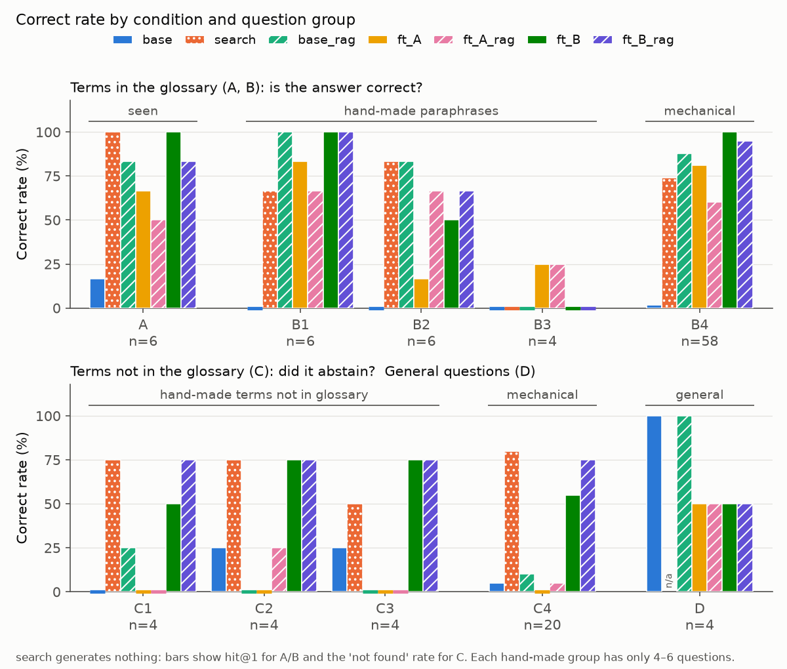
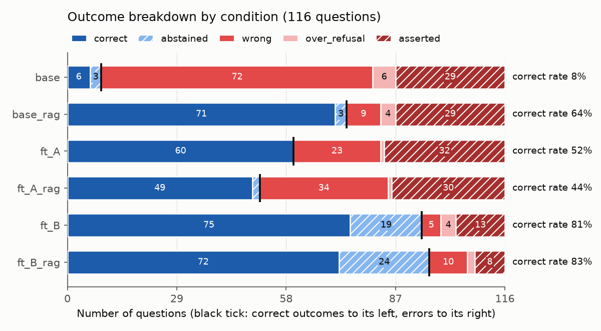
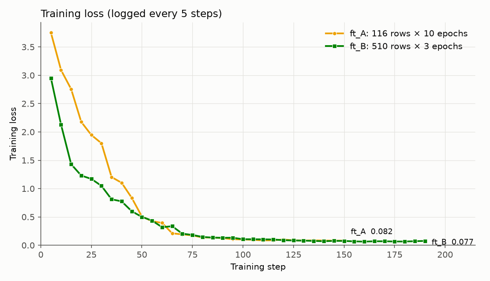

# 第2回 宿題（発展）集計

`uv run --with matplotlib python -m scripts.plot_lec02` で生成しました。手で編集すると、次の実行で消えます。

- 条件はすべて `Qwen/Qwen3.5-0.8B`（revision 固定）、貪欲生成、同じ 116 問です。評価セットの版は v1、GPU は NVIDIA RTX PRO 6000 Blackwell Server Edition です。
- 1〜6 節の数字は保存された採点の値です。8 節と 10 節の「目視」は原文を読んだ判定で、正解率には混ぜていません。
- 図は `figures/` にあり、最後の節に載せています。

## 1. 条件 × 区分の正解率

| 条件 | A（n=6） | B1（n=6） | B2（n=6） | B3（n=4） | B4（n=58） | C1（n=4） | C2（n=4） | C3（n=4） | C4（n=20） | D（n=4） | 全体 |
| --- | --- | --- | --- | --- | --- | --- | --- | --- | --- | --- | --- |
| base | 17% | 0% | 0% | 0% | 2% | 0% | 25% | 25% | 5% | 100% | 9/116（8%） |
| search（hit@1・断れた） | 100% | 67% | 83% | 0% | 74% | 75% | 75% | 50% | 80% | – | 82/112（73%） |
| search（hit@3） | 100% | 100% | 83% | 0% | 98% | – | – | – | – | – | 74/80（92%） |
| base_rag | 83% | 100% | 83% | 0% | 88% | 25% | 0% | 0% | 10% | 100% | 74/116（64%） |
| ft_A | 67% | 83% | 17% | 25% | 81% | 0% | 0% | 0% | 0% | 50% | 60/116（52%） |
| ft_A_rag | 50% | 67% | 67% | 25% | 60% | 0% | 25% | 0% | 5% | 50% | 51/116（44%） |
| ft_B | 100% | 100% | 50% | 0% | 100% | 50% | 75% | 75% | 55% | 50% | 94/116（81%） |
| ft_B_rag | 83% | 100% | 67% | 0% | 95% | 75% | 75% | 75% | 75% | 50% | 96/116（83%） |

A〜D の意味：A は学習と同じ聞き方、B1 は新しい聞き方、B2 は別名、B3 は名前を出さない質問、B4 は機械的な言い換え、C1〜C3 は手作りの「用語集にない語」（実在・講義に出た語・架空）、C4 は機械的な「用語集にない語」、D は普通の質問です。

`search` は生成をしないので、同じ物差しではありません。A・B は 1 件目が正しい語か（hit@1）、C は「見つかりませんでした」を返したかで数えています。D は対象外です。B1〜B3 と C1〜C3 は各 4〜6 問なので、1 問で 17〜25 ポイント動きます。

## 2. 手作りと機械的な拡張の比較

| 条件 | B 手作り（B1〜B3） | B 機械的（B4） | C 手作り（C1〜C3） | C 機械的（C4） |
| --- | --- | --- | --- | --- |
| base | 0/16（0%） | 1/58（2%） | 2/12（17%） | 1/20（5%） |
| search | 9/16（56%） | 43/58（74%） | 8/12（67%） | 16/20（80%） |
| base_rag | 11/16（69%） | 51/58（88%） | 1/12（8%） | 2/20（10%） |
| ft_A | 7/16（44%） | 47/58（81%） | 0/12（0%） | 0/20（0%） |
| ft_A_rag | 9/16（56%） | 35/58（60%） | 1/12（8%） | 1/20（5%） |
| ft_B | 9/16（56%） | 58/58（100%） | 8/12（67%） | 11/20（55%） |
| ft_B_rag | 10/16（62%） | 55/58（95%） | 9/12（75%） | 15/20（75%） |

- **C（用語集にない語）は傾向が一致します。** 手作りでも機械的でも、`ft_B` と `ft_B_rag` だけが過半数を断れ、他の生成の条件は 2 割以下です。
- **B（言い換え）は一致しません。** 手作りの最高は `base_rag`（69%）、機械的の最高は `ft_B`（100%）で、順位が変わります。機械的の B4 は質問に用語名がそのまま入っていますが、手作りには別名（B2）と名前を出さない質問（B3）が含まれます。`ft_B` が B4 で 100% でも、それだけでは「言い換え全般に強い」とは言えません。

## 3. outcome の内訳

| 条件 | correct | abstained | wrong | over_refusal | asserted | 正解 |
| --- | --- | --- | --- | --- | --- | --- |
| base | 6 | 3 | 72 | 6 | 29 | 9/116 |
| base_rag | 71 | 3 | 9 | 4 | 29 | 74/116 |
| ft_A | 60 | 0 | 23 | 1 | 32 | 60/116 |
| ft_A_rag | 49 | 2 | 34 | 1 | 30 | 51/116 |
| ft_B | 75 | 19 | 5 | 4 | 13 | 94/116 |
| ft_B_rag | 72 | 24 | 10 | 2 | 8 | 96/116 |

`correct` と `abstained` が正解です。`search` は生成をしないので、この表にはありません。正規表現の誤判定の影響は 10 節に書きました。

## 4. answer 型の scope 別（一般・講座固有）

| 条件 | 一般 正解率 | 一般 rougeL 平均 | 一般 rougeL 中央値 | 講座固有 正解率 | 講座固有 rougeL 平均 | 講座固有 rougeL 中央値 |
| --- | --- | --- | --- | --- | --- | --- |
| base | 2/68（3%） | 0.167 | 0.164 | 0/12（0%） | 0.158 | 0.147 |
| search（hit@1） | 48/68（71%） | – | – | 10/12（83%） | – | – |
| base_rag | 58/68（85%） | 0.577 | 0.604 | 9/12（75%） | 0.494 | 0.514 |
| ft_A | 52/68（76%） | 0.824 | 1.000 | 6/12（50%） | 0.553 | 0.308 |
| ft_A_rag | 40/68（59%） | 0.703 | 0.752 | 7/12（58%） | 0.715 | 0.742 |
| ft_B | 62/68（91%） | 0.933 | 1.000 | 11/12（92%） | 0.921 | 1.000 |
| ft_B_rag | 60/68（88%） | 0.895 | 1.000 | 10/12（83%） | 0.849 | 1.000 |

## 5. 学習前後で ok→ng になった質問

### base → ft_A（ok→ng 6 問、ng→ok 57 問）

| id | 質問 | outcome | 学習後の原文（先頭） |
| --- | --- | --- | --- |
| A1 | 「LoRA」とは何ですか？ | correct → wrong | LoRA（低ランク非線形重み学習）は、学習する重みの大きさを大きくするのではなく、2つの小さな行列の積（2つの小さな行列の積は非常に小さい）で学習する学習方法。学習する重みの数が少… |
| C2-4 | 蒸留（ディスティレーション）とは何ですか？ | abstained → asserted（前の ok は目視で誤判定） | アルコールを水分から分離する技術。沸点の違いを利用し、アルコールを液体からガスにしたり、水分を液体からガスにしたりする。分離の効率とコスト、結果の安定性を考える。 |
| C3-4 | AIE2026 の「週次ボーナス課題」とは何ですか？ | abstained → asserted | 各回の演習で、習題の解決や宿題の提出で評価する作業。3回の演習で2つの宿題を提出させる（週次ボーナス）。提出前に用語集に必ず載るべき用語を覚える。 |
| D2 | 「ありがとう」を英語にしてください。 | correct → wrong | You're welcome! 😊 |
| D3 | 1 から 10 までの整数の和はいくつですか？ | correct → wrong | 1+2+3+4+5+6+7+8+9 = 45 |
| C4-18 | AIE2026 の特別演習パスという用語の意味を、短く説明してください。 | abstained → asserted | AIE2026の講座「AIエンジニアリング実践 2026」では、各回の演習で習う技術や概念を自分で選んだパスで走らせる。同じ講座でも経験や状況でパスを変えるのが可能。本講座は回ごと… |

### base → ft_B（ok→ng 2 問、ng→ok 87 問）

| id | 質問 | outcome | 学習後の原文（先頭） |
| --- | --- | --- | --- |
| D3 | 1 から 10 までの整数の和はいくつですか？ | correct → wrong | 9 の和です。 |
| D4 | Python でリストの長さを調べる組み込み関数は何ですか？ | correct → wrong | list的长度。Pydantic AIのモデルはツールの引数个数を1つに絞るため、呼び出し数が予測される上限に達するほどモデルが学習しすぎることがある。 |

### base_rag → ft_A_rag（ok→ng 31 問、ng→ok 8 問）

| id | 質問 | outcome | 学習後の原文（先頭） |
| --- | --- | --- | --- |
| A2 | 「ハルシネーション」とは何ですか？ | correct → wrong | LLMが知らないこと（最新情報、講座に固有の情報など）を聞いたときに起きやすい。外部データをツールで参照させる、根拠を示させる、評価で検出する、などで抑える。 |
| A4 | 「宿題の3レベル」とは何ですか？ | correct → wrong | 講義内容の確認、自分でコードを書く、調査や試行的2段階があり、どれか1つに取り組めばその回の宿題は完了。原則として採点はしない。 |
| A5 | 「既定モデル」とは何ですか？ | correct → wrong | 講座運営の安定性と無料枠のレート制限を考慮したモデル。環境変数 AIE\_MODEL で他のモデルに切り替えてよく、自分で契約したAPIを使ってもよい。 |
| B1-3 | レート制限について、初心者にもわかるように教えてください。 | correct → over_refusal | LLMを複数回呼ぶため、質問数や質問の多様さで上限に達しやすい。無料枠は特に制限が厳しく、用語集にない用語なら「その用語は用語集にありません。」と答える。 |
| B1-4 | ハーネスという言葉は何を指しますか？ | correct → wrong | LLMのプログラムを3レベルから絞った薄いツール（read・write・edit・bash）で、そのツールを呼び出して実際に作業できるようにするプログラム。Claude Codeや… |
| B2-1 | Low-Rank Adaptation とは何ですか？ | correct → wrong | LoRAで学習する重みを小さくする手法。学習するパラメータとメモリを減らせる。本講座の第2回演習では扱う。 |
| C1-2 | Transformer とは何ですか？ | abstained → asserted | LLMのモデルを2つの層に分割した設計。モデルが学習する重みは、入力と出力の間の経路。その中の中間の層を「橋」や「ループ」で繋いで、出力をモデルに戻す。Pydantic AIではこ… |
| D2 | 「ありがとう」を英語にしてください。 | correct → wrong | You're welcome! 😊 |
| D3 | 1 から 10 までの整数の和はいくつですか？ | correct → wrong | 1+2+3+4+5+6+7+8+9 = 45 |
| B4-01 | AIエンジニアリングという用語の意味を、短く説明してください。 | correct → wrong | モデルを扱うための技術領域。モデルを自分で作ることより、モデルの選択、データやツールとの接続、評価と改善のサイクルを回すことに重心がある。 |
| B4-06 | プロンプトという用語の意味を、短く説明してください。 | correct → wrong | LLMに渡す入力。指示の内容や形式、出力の型、例などを書き込むことで出力を方向づけられる。指示の書き方（JSON・Markdown・チャットなど）はツールやエディタで調整できる。 |
| B4-08 | temperatureという用語の意味を、短く説明してください。 | correct → wrong | 次の質問を返すときの回答の多様さを調整する設定値。低いほど回答が安定し、高いほど多様になる。同じ質問でも回答が変わる理由の一つ。 |
| B4-09 | ハルシネーションという用語の意味を、短く説明してください。 | correct → wrong | LLMが知らないこと（最新情報、講座に固有の情報など）を聞いたときに起きやすい現象。外部データをツールで参照させる、根拠を示させる、評価で検出する、などで抑える。 |
| B4-10 | APIという用語の意味を、短く説明してください。 | correct → wrong | 講座の関数APIを呼び出してモデルに質問させるための窓口。本講座ではPythonからGeminiのAPIを呼び出してLLMを起動し、関数として使う。 |
| B4-14 | GitHub Codespacesという用語の意味を、短く説明してください。 | correct → wrong | ブラウザからVS Codeを開き、repoに書かれた設定どおりの環境をすぐに使える開発環境。無料枠は使わないときは停止しないと消費し続ける。 |
| B4-15 | devcontainerという用語の意味を、短く説明してください。 | correct → wrong | 開発環境をプログラムから呼び出せるように定義する仕組み。設定ファイルにPythonのバージョンや拡張機能、起動時のコマンドを書いておくと、誰がCodespacesを開いても同じ環境… |
| B4-16 | Codespaces secretという用語の意味を、短く説明してください。 | correct → wrong | 登録したrepoのCodespacesを起動すると渡される環境変数。起動中に登録した場合はCodespacesを再起動が必要。 |
| B4-17 | forkという用語の意味を、短く説明してください。 | correct → wrong | AIE2026で使うrepoを自分のforkにする。本講座は講座repoをforkし、自分のfork上で作業・提出する。 |
| B4-18 | ブランチという用語の意味を、短く説明してください。 | correct → wrong | AIE2026で扱うforkのmainを壊さずに変更を試し、結果が確認できたときは main に取り込む。回ごとに lec01 のようなブランチを作る。 |
| B4-22 | コーディングエージェントという用語の意味を、短く説明してください。 | correct → wrong | Claude CodeやCopilotのエージェントモード、Piなどのツールを呼ばずに作業を自主的に進めるAI。モデルが指示を出し、結果を見て次の行動を決めるLLM＋ループ＋ツール… |
| B4-23 | 事前学習という用語の意味を、短く説明してください。 | correct → wrong | モデルを広く使うテキストで、次のトークンを予測するように学習させる最初の段階。言語の知識や一般的な常識の多くはここで身につく。 |
| B4-26 | PEFTという用語の意味を、短く説明してください。 | correct → wrong | LoRAで学習するGPUメモリと保存容量を大きく減らせる。必要なGPUメモリと保存容量はモデルの全パラメータで決めるほど大きくなり、LoRAでは2つのパラメータ（重みとベクトル）を… |
| B4-27 | LoRAという用語の意味を、短く説明してください。 | correct → wrong | 学習するパラメータが少なく、学習結果（アダプタ）も小さいファイルで保存できるPEFT手法。本講座の第2回演習ではLoRAを扱う。 |
| B4-40 | ハーネスという用語の意味を、短く説明してください。 | correct → wrong | LLMのプログラムを、作業を支援するようプログラムする、Claude CodeやPiのようなツールをread・write・edit・bashの4つに絞った薄いハーネスとして持つ、P… |
| B4-42 | Pydantic AIという用語の意味を、短く説明してください。 | correct → wrong | AIE2026の用語集にあり、第3回の本線。モデルを呼び出す前に定義した型を使ってツールの引数や出力を把握でき、テスト用のモデルでAPIを呼ばずに動作確認できる。モデルが学習した事… |
| B4-44 | MCP（Model Context Protocol）という用語の意味を、短く説明してください。 | correct → wrong | MCPサーバーとして公開したツールは、対応する様々なエージェントやエディタ（MCPクライアント）から共通の方法で使える。第5回で、用語集の検索をMCPサーバーにして体験する。 |
| B4-45 | ガードレールという用語の意味を、短く説明してください。 | correct → wrong | 指示文でルールや権限を絞る、出力をチェックする、確認を挟む、などの方法で、エージェントの行動を制限する。指示文でのルールは、ツールを呼ばずに行動を控える。 |
| B4-49 | answer.mdという用語の意味を、短く説明してください。 | correct → wrong | 各回の演習・宿題の結果を書くファイル。結果を記入し、自分のforkの main へPRを出して提出する。 |
| B4-54 | MCPクライアントという用語の意味を、短く説明してください。 | correct → wrong | ツールをモデルに渡して、モデルの指示で呼び出す側。プログラムのクライアント（Cursor、Pydantic AIの MCPToolsetなど）や、チャット・エディタ・アプリなどのツ… |
| C4-11 | 迎合（シコファンシー）という用語の意味を、短く説明してください。 | abstained → asserted | LLMが自分の振る舞いや結果を標準にすると、利用者が反感actoryに感じる状態。モデルが標準にすると、利用者が納得する結果を返す設計や、ツールで結果を返す、などの対策や手法がある… |
| C4-18 | AIE2026 の特別演習パスという用語の意味を、短く説明してください。 | abstained → asserted | 講座の配布ファイルに載る演習の録音と宿題の提出リンク。録音は「聴覚で確認できる」が、提出は「手描いで確認できる」双方の確認方法を組み合わせる。提出時に使うAPIキーは公開しない。 |

### base_rag → ft_B_rag（ok→ng 7 問、ng→ok 29 問）

| id | 質問 | outcome | 学習後の原文（先頭） |
| --- | --- | --- | --- |
| A2 | 「ハルシネーション」とは何ですか？ | correct → wrong | LLMが知らないこと（最新情報、組織や講座に固有の情報など）を聞いたときに起きやすい。モデルが知らないこと（最新情報、組織や講座に固有の情報など）を聞いたときに起きやすい。外部デー… |
| B2-1 | Low-Rank Adaptation とは何ですか？ | correct → wrong | 事前学習済みの重みのまま、学習するパラメータが少なく、学習結果（アダプタ）も小さい行列の積（低ランク行列）で表し、その小さな行列だけを学習するPEFT手法。本講座の第2回演習ではL… |
| D3 | 1 から 10 までの整数の和はいくつですか？ | correct → wrong | 9 の和です。 |
| D4 | Python でリストの長さを調べる組み込み関数は何ですか？ | correct → wrong | list的长度。Pydantic AIのモデルはツールの引数个数を1つに絞るため、呼び出し数が予測される上限に達するほどモデルが学習しすぎることがある。 |
| B4-09 | ハルシネーションという用語の意味を、短く説明してください。 | correct → wrong | LLMが知らないこと（最新情報、組織や講座に固有の情報など）を聞いたときに起きやすい。外部データをツールで参照させる、根拠を示させる、評価で検出する、などで抑える。 |
| B4-19 | プルリクエスト（PR）という用語の意味を、短く説明してください。 | correct → wrong | あるブランチの変更を別のブランチへ依頼する仕組み。差分の確認、コミットメッセージ、テスト結果表示ができる。本講座の提出は、自分のfork内で作業ブランチから main へのPRとし… |
| B4-49 | answer.mdという用語の意味を、短く説明してください。 | correct → wrong | AIE2026で各回の演習・宿題の結果を書くファイル。結果はブランチ「works-of-the-week/{lecture-number}"から取り出せる。 |

## 6. A と B の学習の数字

| 項目 | A | B |
| --- | --- | --- |
| 学習データの件数 | 116 | 510 |
| エポック | 10 | 3 |
| ステップ（実行 / 予定） | 150 / 150 | 192 / 192 |
| warmup / 保存の間隔 | 15 / 38 | 19 / 48 |
| 学習時間（秒） | 45.9 | 68.0 |
| 最終 loss（最後に記録した値） | 0.0824 | 0.0768 |
| 平均 loss（学習全体） | 0.7352 | 0.4227 |
| trainable% | 0.842 | 0.842 |
| 学習するパラメータ / 全体 | 6,389,760 / 758,782,784 | 6,389,760 / 758,782,784 |
| fp16 / bf16 | False / False | False / False |
| 生成の時間（検索なし、116 問、秒） | 106.3 | 86.2 |
| 生成の時間（検索あり、116 問、秒） | 107.7 | 80.3 |

学習前の生成時間（116 問）は、`base` が 200.2 秒、`base_rag` が 137.4 秒です（A の回）。

## 7. 再現性

ノートブックの `RUN_BASELINES` の行を `VARIANT == "B"` に書き換えて実行したため、B の回でも学習前の評価が走りました。その出力は `colab/B_run_baselines/` にあります。集計の `base` と `base_rag` には A の回の結果を使っています。

| ラベル | raw が一致した問題 | outcome が一致した問題 |
| --- | --- | --- |
| base | 116/116 | 116/116 |
| base_rag | 116/116 | 116/116 |

- **学習前の生成は、別のセッションでも 116 問すべて同じ文字列でした。** GPU は両方とも NVIDIA RTX PRO 6000 Blackwell Server Edition、コミットは bd36629 です。
- 確かめられたのは、同じ機種での学習前の貪欲生成だけです。学習は A・B とも 1 回ずつなので、学習の再現性は確かめていません。
- 保存された `outcome`・`ok`・`rougeL` は、いまの `scripts/glossary_eval.py` と `eval_set.json` で採点し直しても、6 ラベルの全行で一致しました。
- D は検索を使わないので、検索の有無が違うだけのラベル同士で原文が一致します（確認結果：全問一致）。
- 検索の結果は `search_eval_20261101-210205.csv` を使いました。

## 8. D（普通の質問）の原文

「目視」は原文を読んだ判定で、正解率には入れていません。検索の有無で原文は変わらないので、目視の判定は `ft_A` などの 3 組で共通です。

### D1：日本の首都はどこですか？（必須語句：東京）

| 条件 | outcome | 目視 | 原文 |
| --- | --- | --- | --- |
| base | correct | 問題なし | 日本の首都は\*\*東京\*\*です。  東京は日本最大の都市であり、日本経済の中心地、政治・行政の中心地、そして文化の中心地となっています。また、東京は世界で最も人口が多い都市の一つであり、世界最大の都市圏の一つでもあります。 |
| base_rag | correct | 問題なし | 日本の首都は\*\*東京\*\*です。  東京は日本最大の都市であり、日本経済の中心地、政治・行政の中心地、そして文化の中心地となっています。また、東京は世界で最も人口が多い都市の一つであり、世界最大の都市圏の一つでもあります。 |
| ft_A | correct | 東京と答えるが、続きが壊れている（「モデル首都」など） | 東京。2025年10月の国会議事堂の配置で、本講座では第3回の演習では東京をモデル首都として扱う。 |
| ft_A_rag | correct | 東京と答えるが、続きが壊れている（「モデル首都」など） | 東京。2025年10月の国会議事堂の配置で、本講座では第3回の演習では東京をモデル首都として扱う。 |
| ft_B | correct | 壊れている（架空の住所、同じ文の反復） | 東京都の中心部。本館がlocated atの場所。本館の住所は東京都港区三ัญ機一丁目2番1号。本館の地図はhttps://www.metro.tokyo.jp/en/visit/entrance.htmlにあり、本館の位置を簡単に把握できる。本館の地図は公開されている。本館の地図は公開されている。本館の地図は公開されている。本館の地図は公開されている。本館の地図は公開されている。本館の地図は公開されている。本館の地図は公開されている。本館の地図は公開されている。本館の地図は公開されている。本館の地図は公開されている。本館の地図は公開されている。本館の地図は公開されている。本館の地図は公開されている。本館の地図は公開されている。本館の地図は公開されている。本館の地図は公開されている。本館 |
| ft_B_rag | correct | 壊れている（架空の住所、同じ文の反復） | 東京都の中心部。本館がlocated atの場所。本館の住所は東京都港区三ัญ機一丁目2番1号。本館の地図はhttps://www.metro.tokyo.jp/en/visit/entrance.htmlにあり、本館の位置を簡単に把握できる。本館の地図は公開されている。本館の地図は公開されている。本館の地図は公開されている。本館の地図は公開されている。本館の地図は公開されている。本館の地図は公開されている。本館の地図は公開されている。本館の地図は公開されている。本館の地図は公開されている。本館の地図は公開されている。本館の地図は公開されている。本館の地図は公開されている。本館の地図は公開されている。本館の地図は公開されている。本館の地図は公開されている。本館の地図は公開されている。本館 |

### D2：「ありがとう」を英語にしてください。（必須語句：thank）

| 条件 | outcome | 目視 | 原文 |
| --- | --- | --- | --- |
| base | correct | Thank you はあるが、You're welcome などの誤った訳が混ざる | "Thank you" is commonly translated as:  - \*\*Thank you\*\* (most common) - \*\*You're welcome\*\* (if you're offering to do something) - \*\*I'm glad you're here\*\* (if you're asking for something) - \*\*Thank you very much\*\* (if you're being polite)  For example: - "Thank you for your help!" → "Thank you for your help!" - "You're welcome!" → "You're welcome!" - "I'm glad you're here!" → "I'm glad you're here!"  Let me know if you need it for a specific context! |
| base_rag | correct | Thank you はあるが、You're welcome などの誤った訳が混ざる | "Thank you" is commonly translated as:  - \*\*Thank you\*\* (most common) - \*\*You're welcome\*\* (if you're offering to do something) - \*\*I'm glad you're here\*\* (if you're asking for something) - \*\*Thank you very much\*\* (if you're being polite)  For example: - "Thank you for your help!" → "Thank you for your help!" - "You're welcome!" → "You're welcome!" - "I'm glad you're here!" → "I'm glad you're here!"  Let me know if you need it for a specific context! |
| ft_A | wrong | 誤り（You're welcome） | You're welcome! 😊 |
| ft_A_rag | wrong | 誤り（You're welcome） | You're welcome! 😊 |
| ft_B | correct | 問題なし | Thank you. |
| ft_B_rag | correct | 問題なし | Thank you. |

### D3：1 から 10 までの整数の和はいくつですか？（必須語句：55）

| 条件 | outcome | 目視 | 原文 |
| --- | --- | --- | --- |
| base | correct | 55 と答えるが、途中の計算が 56 や 35 になり矛盾する | 整数 1 から 10 までの和は、\*\*55\*\* です。  計算方法は以下の通りです： 1.  1 と 10 の和は：\$1 + 10 = 11\$ 2.  1 から 9 の和は：\$1 + 2 + 3 + \\dots + 9 = 45\$ 3.  合計：\$11 + 45 = 56\$  （あるいは、1 から 10 の和は、1 から 9 の和から 10 を引くことで得られます：\$45 - 10 = 35\$） |
| base_rag | correct | 55 と答えるが、途中の計算が 56 や 35 になり矛盾する | 整数 1 から 10 までの和は、\*\*55\*\* です。  計算方法は以下の通りです： 1.  1 と 10 の和は：\$1 + 10 = 11\$ 2.  1 から 9 の和は：\$1 + 2 + 3 + \\dots + 9 = 45\$ 3.  合計：\$11 + 45 = 56\$  （あるいは、1 から 10 の和は、1 から 9 の和から 10 を引くことで得られます：\$45 - 10 = 35\$） |
| ft_A | wrong | 誤り（9 までの和） | 1+2+3+4+5+6+7+8+9 = 45 |
| ft_A_rag | wrong | 誤り（9 までの和） | 1+2+3+4+5+6+7+8+9 = 45 |
| ft_B | wrong | 壊れている | 9 の和です。 |
| ft_B_rag | wrong | 壊れている | 9 の和です。 |

### D4：Python でリストの長さを調べる組み込み関数は何ですか？（必須語句：len）

| 条件 | outcome | 目視 | 原文 |
| --- | --- | --- | --- |
| base | correct | 問題なし | Python でリストの長さを調べる組み込み関数は \*\*\`len()\`\*\* です。  この関数はリストの要素数（リストの長さ）を返します。例えば、リスト \`['a', 'b', 'c']\` の場合は \`len(['a', 'b', 'c'])\` が \`3\` として返します。  \`\`\`python list = ['a', 'b', 'c'] print(len(list))  # 出力: 3 \`\`\`  もしリストが空の場合（空リスト \`[]\`）も返すため、\`len([])\` は \`0\` として返します。 |
| base_rag | correct | 問題なし | Python でリストの長さを調べる組み込み関数は \*\*\`len()\`\*\* です。  この関数はリストの要素数（リストの長さ）を返します。例えば、リスト \`['a', 'b', 'c']\` の場合は \`len(['a', 'b', 'c'])\` が \`3\` として返します。  \`\`\`python list = ['a', 'b', 'c'] print(len(list))  # 出力: 3 \`\`\`  もしリストが空の場合（空リスト \`[]\`）も返すため、\`len([])\` は \`0\` として返します。 |
| ft_A | correct | len() と答えるが、続きが壊れている | len()。モデルの誘導（Prompting）では、指示文の長さを決めるために使う。指示が長いときに、ツール呼び出しを複数回呼ぶ（ツールが複数あるとき）或者、レート制限を壊す可能性がある。 |
| ft_A_rag | correct | len() と答えるが、続きが壊れている | len()。モデルの誘導（Prompting）では、指示文の長さを決めるために使う。指示が長いときに、ツール呼び出しを複数回呼ぶ（ツールが複数あるとき）或者、レート制限を壊す可能性がある。 |
| ft_B | wrong | 壊れている（len が出ず、無関係な文が続く） | list的长度。Pydantic AIのモデルはツールの引数个数を1つに絞るため、呼び出し数が予測される上限に達するほどモデルが学習しすぎることがある。 |
| ft_B_rag | wrong | 壊れている（len が出ず、無関係な文が続く） | list的长度。Pydantic AIのモデルはツールの引数个数を1つに絞るため、呼び出し数が予測される上限に達するほどモデルが学習しすぎることがある。 |

| モデル | 必須語句で correct | 目視で問題なし |
| --- | --- | --- |
| base | 4/4 | 2/4 |
| ft_A | 2/4 | 0/4 |
| ft_B | 2/4 | 1/4 |

必須語句だけで見ると `ft_A` と `ft_B` は 2/4 ですが、`ft_A` の D1・D4 と `ft_B` の D1 は語句が合っているだけで、続きが壊れています。`base` の D2・D3 も語句は合っていますが、中身に誤りがあります。D は 4 問だけなので、目視の差も傾向の目安にとどまります。

## 9. 必須語句の判定と ROUGE-L の食い違い

`correct` なのに ROUGE-L < 0.2、`wrong` か `over_refusal` なのに ROUGE-L > 0.8 の答えを、条件ごとに最大 3 件ずつ並べました。閾値に当たる答えが 3 件に満たないときは、次に近い答えを「参考」として足しています（correct は 0.5 未満、NG は 0.5 超のものだけ）。

### base（correct かつ < 0.2：1 件、wrong・over_refusal かつ > 0.8：0 件）

| id | 種類 | rougeL | outcome | 足りない語句 | 原文（先頭） |
| --- | --- | --- | --- | --- | --- |
| A1 | correct < 0.2 | 0.13 | correct | — | 「LoRA（Low-Rank Adaptation）」は、大規模言語モデル（LLM）のトレーニングにおいて、\*\*「低ランク（Low-Rank）」\*\*の知識を、\*\*「低ランク（Low… |
| B4-15 | 参考 | 0.21 | correct | — | devcontainer は、開発環境を構築するための「コンテナ」です。  このコンテナには、開発者にとって必要なすべてのツール（Python、Node.js、Git、VS Cod… |

### base_rag（correct かつ < 0.2：0 件、wrong・over_refusal かつ > 0.8：0 件）

| id | 種類 | rougeL | outcome | 足りない語句 | 原文（先頭） |
| --- | --- | --- | --- | --- | --- |
| B1-3 | 参考 | 0.20 | correct | — | 「レート制限」は、AI エンジニアリングの初心者でも非常に重要な概念です。一言で言うと、\*\*「AI エージェントが、特定の時間あたりに何回も質問やトークンを呼び出せるか、その上限を… |
| B4-53 | 参考 | 0.24 | correct | — | MCP サーバーは、MCP（Model Context Protocol）プロトコルでツールやリソースを公開し、クライアントがその情報を基に AI アプリやエディタを実行する側です… |
| B4-56 | 参考 | 0.29 | correct | — | 「mcpServers 設定」は、AI アプリケーションで使用する MCP サーバーをリストアップする設定ファイルのことです。 この設定ファイルには、各サーバーの名前と起動方法（s… |
| B4-21 | 参考 | 0.76 | wrong | 続き | コード補完は、書きかけのコードやコメントから、AI が提案する機能です。提案は正しいとは限らないので、読んで理解してから採用するのが一般的です。 |
| B4-51 | 参考 | 0.65 | wrong | gemini-3.5-flash-lite | 既定モデルとは、AIE2026 の演習と宿題で標準に使うモデルを指します。 無料枠のレート制限と講座運営の安定性を考慮し、環境変数 \`AIE\_MODEL\` で他のモデルに切り替える… |
| B4-32 | 参考 | 0.60 | wrong | 1周／一周／1回 | 「エポック」は、学習データ全体を 1 回学習することを意味します。回数を増やしすぎると過学習（過学習）しやすいため、学習を止めるために設定します。 |

### ft_A（correct かつ < 0.2：0 件、wrong・over_refusal かつ > 0.8：2 件）

| id | 種類 | rougeL | outcome | 足りない語句 | 原文（先頭） |
| --- | --- | --- | --- | --- | --- |
| B3-3 | 参考 | 0.30 | correct | — | 各回の演習で使う同一のコードの書き方。回ごとにタグ付けることで、回を切り離す。例：lec01-start, lec02-start, ... |
| B2-2 | 参考 | 0.41 | correct | — | モデルが事実と異なる内容や存在しない情報を、もっともらしく正しい形式で返す現象。学習データにだけ絞ったツールや、フィードウォールが過学習しやすい環境で起きやすい。 |
| B4-57 | 参考 | 0.48 | correct | — | 複数のMCPサーバーを使うとき、同じ名前のツールを区別するために「サーバー名\_ツール名」のように接頭辞を付けること。本講座の用語集では用語の名前空間は「用語\_説明」。ツールはサーバ… |
| B4-44 | NG > 0.8 | 0.91 | over_refusal | — | AIアプリと外部のツールやデータソースをつなぐためのオープンな標準プロトコル。MCPサーバーとして公開したツールは、対応する様々なエージェントやエディタ（MCPクライアント）から共… |
| B4-01 | NG > 0.8 | 0.86 | wrong | 基盤モデル | 学習済みのモデルをツールとして使い、実際のアプリケーションやシステムを設計・運用・評価・改善する技術領域。モデルを一から作ることより、モデルの選択、ツールとの接続、評価と改善のサイ… |
| B2-1 | 参考 | 0.79 | wrong | 固定 | モデルの重みを2つの小さな行列の積（低ランク）で表し、その小さな行列を学習するだけにする手法。学習するパラメータが少なく、学習結果（アダプタ）も小さいファイルで保存できる。本講座の… |

### ft_A_rag（correct かつ < 0.2：0 件、wrong・over_refusal かつ > 0.8：3 件）

| id | 種類 | rougeL | outcome | 足りない語句 | 原文（先頭） |
| --- | --- | --- | --- | --- | --- |
| B2-5 | 参考 | 0.21 | correct | — | Hugging FaceのHugging Face Inference Serverで、ツールを呼び出すためのプログラム。Server側で処理を断る（MCPの代理として使う）。モデ… |
| B3-1 | 参考 | 0.30 | correct | — | LoRA。LoRAは重みを直接学習しないので、モデルのパラメータが少なく、学習する行列も小さいので、学習するGPUメモリと保存するパラメータも小さくなる。 |
| B4-33 | 参考 | 0.30 | correct | — | 学習に使わない検証データで性能を測って気づく、未知の入力に対する性能が落ちる状態。モデルが学習データにだけ過度に適合し、知識が記憶に固定した、知識が記憶に固定した、記憶が知識に沿っ… |
| B4-23 | NG > 0.8 | 0.87 | wrong | 大量 | モデルを広く使うテキストで、次のトークンを予測するように学習させる最初の段階。言語の知識や一般的な常識の多くはここで身につく。 |
| B4-08 | NG > 0.8 | 0.82 | wrong | ランダム | 次の質問を返すときの回答の多様さを調整する設定値。低いほど回答が安定し、高いほど多様になる。同じ質問でも回答が変わる理由の一つ。 |
| B4-44 | NG > 0.8 | 0.82 | wrong | プロトコル／標準 | MCPサーバーとして公開したツールは、対応する様々なエージェントやエディタ（MCPクライアント）から共通の方法で使える。第5回で、用語集の検索をMCPサーバーにして体験する。 |

### ft_B（correct かつ < 0.2：0 件、wrong・over_refusal かつ > 0.8：1 件）

| id | 種類 | rougeL | outcome | 足りない語句 | 原文（先頭） |
| --- | --- | --- | --- | --- | --- |
| B3-4 | NG > 0.8 | 0.97 | wrong | Human-in-the-loop／HITL | 処理の途中に人の確認や承認を組み込むこと。データの書き込みや送信など、取り消しにくい操作の前に使う。Pydantic AIでは requires\_approval=True を指定… |

### ft_B_rag（correct かつ < 0.2：0 件、wrong・over_refusal かつ > 0.8：2 件）

| id | 種類 | rougeL | outcome | 足りない語句 | 原文（先頭） |
| --- | --- | --- | --- | --- | --- |
| B4-52 | 参考 | 0.45 | correct | — | モデルが外部のサービスやデータを呼び出すための仕組み。モデルはツールの名前・説明・引数の型を見て、必要なときに引数を決めて呼び出しを依頼し、実行はプログラム側が行う。検索、計算、フ… |
| B4-19 | NG > 0.8 | 0.90 | wrong | 取り込 | あるブランチの変更を別のブランチへ依頼する仕組み。差分の確認、コミットメッセージ、テスト結果表示ができる。本講座の提出は、自分のfork内で作業ブランチから main へのPRとし… |
| B4-09 | NG > 0.8 | 0.81 | wrong | 事実と異なる／存在しない かつ もっともらしく | LLMが知らないこと（最新情報、組織や講座に固有の情報など）を聞いたときに起きやすい。外部データをツールで参照させる、根拠を示させる、評価で検出する、などで抑える。 |
| A2 | 参考 | 0.76 | wrong | 事実と異なる／存在しない かつ もっともらしく | LLMが知らないこと（最新情報、組織や講座に固有の情報など）を聞いたときに起きやすい。モデルが知らないこと（最新情報、組織や講座に固有の情報など）を聞いたときに起きやすい。外部デー… |

読むときの要点：

- **`wrong` で ROUGE-L > 0.8 の 7 件のうち 6 件は、採点が厳しすぎるのではなく、定義の一部が実際に変わっています。** `ft_A` の B4-01 は「基盤モデル」が「モデル」に、`ft_A_rag` の B4-23 は「大量の汎用テキスト」が「広く使うテキスト」に、B4-08 は「次のトークンを選ぶときのランダムさ」が「次の質問を返すときの回答の多様さ」に変わっています。`ft_A_rag` の B4-44 と `ft_B_rag` の B4-09 は定義の先頭の文が落ち、`ft_B_rag` の B4-19 は「取り込むよう」が落ちています。文字の一致が高くても意味が変わるので、ROUGE-L だけでは正誤を判断できません。
- 残りの 1 件、`ft_B` の B3-4（0.97）は定義文をほぼそのまま返していますが、質問が求める用語名を答えていません。名前を問う B3 では、ROUGE-L は参考になりません。
- `ft_A` の B4-44（0.91、`over_refusal`）は、定義は正しいのに断る表現に当たった誤判定です（10 節）。
- `correct` で ROUGE-L < 0.2 は `base` の A1（0.13）だけです。原文は「知識の容量」を「低ランクに固定化」するという誤った説明で、語句が合っただけです。
- **`ft_B` の answer 型の `correct` 73 問のうち、定義文と完全に一致するのは 73 問です。** 学習していない聞き方でも正しい定義文を呼び出せたことは示しますが、自分の言葉で説明できたことは示しません。

## 10. 断る判定になった答えの原文と、正規表現の誤判定

正規表現で `abstained` か `over_refusal` になった答えを、条件ごとに並べました。原文が定型文（「その用語は用語集にありません。」）だけの答えは、id だけを書いています。

目視の分類：**断りのみ**（用語集にないと述べているだけ）、**断り＋説明**（断る文と説明の両方がある。判定は分かれ得る）、**誤判定**（断っていない）。

### base（9 件）

| id | outcome | 目視 | メモ | 一致した表現 | 原文 |
| --- | --- | --- | --- | --- | --- |
| A3 | over_refusal | 断り＋説明 | 断った後に一般的な説明を続ける | 用語集に存在しません | 「コンテキストウィンドウ」は、AI エンジニアリング実践 2026 の用語集に存在しません。  この用語は、一般的に「コンテキストウィンドウ（Context Window）」と呼ばれ、大規模言語モデル（LLM）や機械学習モデルにおいて、モデルが処理する入力データの長さや規模を指す用語です。例えば、テキストベースの AI は、ユーザーが入力するテキストの長さ（例：100 文字〜10,000 文字）を「コンテキストウィンドウ」として定義し、モデルがその中で文脈を理解・生成する仕組みを指します。  ただし、この用語は「コンテキストウィンドウ」という特定の用語集に載っていないため、その定義は用語集に存在しません。 |
| B1-4 | over_refusal | 断り＋説明 | 断った後に誤った説明を続ける | 用語集に存在しません | ハーネス（Harness）は、AI エンジニアリング実践 2026 の用語集に存在しません。  この用語は、主に\*\*機械制御システム\*\*や\*\*ロボット工学\*\*において、操作者が機械を操作するための「手袋」や「手袋の類」として使われる一般的な用語です。例えば、ロボットが操作する機械や、機械が操作するロボットを指す場合、その操作装置を指す言葉として「ハーネス」と使われることがあります。  ただし、AI エンジニアリングの専門用語集では、この用語は定義がありません。 |
| B3-3 | over_refusal | 断り＋説明 | 断りながら別の呼び名を答える | 用語集にありません | AIE2026 の用語集には、\*\*「Git のタグ」\*\*という用語は記載されていません。  AIE2026 の演習では、Git のタグ（tag）は\*\*「バージョン管理の記録」\*\*として扱われるため、その用語は用語集にありません。  演習では、各回の演習開始時点のコードに付いている Git のタグを\*\*「バージョン管理の記録」\*\*と呼びます。 |
| C2-4 | abstained | 誤判定 | 本文は蒸留の説明（断定）。末尾は system プロンプトの写し | 用語集にありません ／ 用語集にない | 蒸留（ディスティレーション）とは、液体を溶媒（通常は水）で溶かして、溶媒を抽出し、溶質（溶媒の成分）を分離・抽出する技術です。  このプロセスは、以下の 3 つのステップで構成されます：  1.  \*\*蒸発\*\*：溶媒を溶かした液体を加熱して、溶媒が蒸発して気化します。 2.  \*\*抽出\*\*：蒸発した気体（溶媒）を抽出器（通常は真空抽出器）で抽出します。 3.  \*\*分離\*\*：抽出された溶媒を回収し、溶質を回収します。  このように、溶媒を抽出することで、溶質を分離・抽出し、最終的に溶質を回収するプロセスを蒸留と呼びます。  ※用語集にない用語なら、「その用語は用語集にありません |
| C3-4 | abstained | 断りのみ | 用語集にないと述べている | 用語集に存在しません | 「週次ボーナス課題」は、AIE2026 の「AI エンジニアリング実践 2026」の用語集に存在しません。  この用語は、一般的に「週次ボーナス課題」という名称で、特定のプロジェクトや課題の名称として使われることがありますが、AIE2026 の用語集には記載されていません。 |
| B4-24 | over_refusal | 断り＋説明 | 説明した後、末尾で断る | 用語集に存在しません | ファインチューニングは、AI モデルの\*\*「最終的な精度向上」\*\*を指します。  モデルが学習した初期の知識やパターンを、実際のデータや環境で実際に使われる\*\*「真のデータ」\*\*に再学習させることで、より高い精度を達成するプロセスです。  ※「ファインチューニング」という用語は、AIE2026 の用語集に存在しません。 |
| B4-48 | over_refusal | 誤判定 | 箇条書きに「用語集にない用語。」が混ざるだけで、本文は説明 | 用語集にない | 「宿題の 3 級」は、AI エンジニアリングの学習・実務における\*\*「レベル別の実務レベル」\*\*を指します。  具体的には、以下の 3 つのレベルに分けられます。  1.  \*\*レベル 1（基礎・入門）\*\*     \*   用語集にない用語。     \*   学習初期や基礎的な AI 知識（機械学習、データ処理、モデル構築など）を学ぶ段階です。 2.  \*\*レベル 2（実務・運用）\*\*     \*   用語集にない用語。     \*   実務で実際に使われる、具体的なプロジェクトや業務フロー（データ処理、モデル訓練、部署管理など）を扱う段階です。 3.  \*\*レベル 3（高度・戦略）\*\*     \*   用語集にない用語。     \*   高度な技術、複雑 |
| B4-54 | over_refusal | 断りのみ | 断っているが、主語は MCP（質問は MCPクライアント） | 用語集に存在しません | MCP（Model Context Protocol）は、AI エンジニアリング実践 2026 の用語集に存在しません。 |
| C4-18 | abstained | 断りのみ | 用語集にないと述べている | 用語集にありません | 「特別演習パス」は、AIE2026 の特別演習パスという用語集にありません。 |

### base_rag（7 件）

定型文だけの答え（1 件）：`abstained` なし ／ `over_refusal` B3-3

| id | outcome | 目視 | メモ | 一致した表現 | 原文 |
| --- | --- | --- | --- | --- | --- |
| B3-1 | over_refusal | 断り＋説明 | 定型文の後に別の用語を説明する | 用語集にありません | その用語は用語集にありません。  「事前学習済みの重みを固定し、小さな行列だけを学習する手法」は、\*\*小規模モデル（Small Model）\*\*や\*\*軽量モデル（Lightweight Model）\*\*の一種であり、その定義は以下の通りです。  \*\*小規模モデル（Small Model）\*\* 小型の言語モデルであり、トレーニングデータが非常に少ないため、学習コストが非常に低く、計算資源（GPU などの計算能力）を必要としないモデルです。  \*\*軽量モデル（Lightweight Model）\*\* 小型の言語モデルであり、トレーニングデータが非常に少ないため、学習コストが非常に低く、計算資源（GPU などの計算能力）を必要としないモデルです。  ※「事前学習済みの重みを固定し、小さな行列だけを学習する手法」という記述は、\*\*小規模モデル\*\*や\*\*軽量モデル\*\*の定義に該当します。 |
| B3-2 | over_refusal | 断り＋説明 | 定型文の後に別の呼び名を答える | 用語集にありません | その用語は用語集にありません。  「学習データ全体を 1 周学習する」という表現は、一般的には「\*\*全データセット学習\*\*（または\*\*全データセット学習\*\*）」と呼びます。これは、学習モデルが学習データ全体（または指定されたサブセット）を 1 回で学習することを指します。  もし「1 周学習」という表現が特定の文脈（例：データセットの構造、学習プロセスのステップ、または特定のパラメータの値）で使われている場合は、その文脈に合わせて「\*\*全データセット学習\*\*」または「\*\*全データセット学習\*\*」を指すことが一般的です。 |
| B3-4 | over_refusal | 断り＋説明 | 定型文の後に別の用語を説明する | 用語集にありません | その用語は用語集にありません。  「AIエージェントの処理の途中に人の承認を組み込むこと」は、\*\*承認フロー（Approval Flow）\*\*や\*\*承認プロセス（Approval Process）\*\*を指す用語集の用語ではありません。  用語集には「承認フロー」や「承認プロセス」などの用語が存在しますが、その定義や具体的な仕組みは記載されていませんでした。 |
| C1-2 | abstained | 断り＋説明 | 断った後に一般的な説明を続ける | 用語集に載っていません | 「Transformer とは何ですか？」は、AIE2026 の用語集に載っていません。  Transformer は、機械学習において非常に重要なモデルの一つで、特に大規模言語モデル（LLM）や自然言語処理において、理解と生成の両方を得意とする「ニューラルネットワーク」です。  主な特徴は以下の通りです： \*   \*\*構造\*\*: 入力と出力を直接接続する「チャネル（Channel）」を有する構造です。 \*   \*\*役割\*\*: 文脈を理解し、自然言語の表現を生成する能力を備えています。 \*   \*\*進化\*\*: 近年、特に大規模言語モデル（LLM）の進化において、最も注目されている技術の一つです。  もし「Transformer」についてさらに詳しい情報（例：具体的なアルゴリズム、応用例、または関連する用語）が必要であれば、お知らせください。 |
| C4-11 | abstained | 断りのみ | 用語集にないと述べている | 用語集にありません | 「迎合（シコファンシー）」という用語は、用語集にありません。 |
| C4-18 | abstained | 断り＋説明 | 架空の説明をした後、末尾で断る | 用語集には該当する用語はありません | AIE2026 の特別演習パスという用語は、\*\*「AI エンジニアリング実践 2026 年度特別演習パス」\*\*を指します。  これは、2026 年 1 月 1 日（または 2 月 1 日）に開催される、AI 分野における特別の演習（特別講座）を指す用語です。  ※「特別演習パス」という表現は、通常「特別演習パス」という言葉自体が一般的ではなく、この特定演習の名称として使われるため、用語集には該当する用語はありません。 |

### ft_A（1 件）

| id | outcome | 目視 | メモ | 一致した表現 | 原文 |
| --- | --- | --- | --- | --- | --- |
| B4-44 | over_refusal | 誤判定 | 定義は正しい。最後の文に「用語集にない用語で」が混ざる | 用語集にない | AIアプリと外部のツールやデータソースをつなぐためのオープンな標準プロトコル。MCPサーバーとして公開したツールは、対応する様々なエージェントやエディタ（MCPクライアント）から共通の方法で使える。第5回で、用語集にない用語で、ツールをMCPサーバーとして公開する例を上げる。 |

### ft_A_rag（3 件）

| id | outcome | 目視 | メモ | 一致した表現 | 原文 |
| --- | --- | --- | --- | --- | --- |
| B1-3 | over_refusal | 誤判定 | 説明の途中に system プロンプトの写しが混ざる | 用語集にありません ／ 用語集にない | LLMを複数回呼ぶため、質問数や質問の多様さで上限に達しやすい。無料枠は特に制限が厳しく、用語集にない用語なら「その用語は用語集にありません。」と答える。 |
| C2-4 | abstained | 断り＋説明 | 誤った説明の後に「用語集にはない」と述べる | 用語集にはない | アルゴリズムの演習で習う基礎用語。用語集にはないため、回答は自分で書く。 |
| C4-07 | abstained | 断り＋説明 | 誤った説明の後に「用語集にない」と述べる | 用語集にない | LLMの周りを、ループ・ツール・画面（UI）などで包み、実際に計算・実行する関数に分割する手法。実行の場所・振る舞い・引数の意味を人間に伝える設計の深さを測る検査の起点。2026年の講座では、用語集にないため、その分野の代表例や発展を列挙する。 |

### ft_B（23 件）

定型文だけの答え（23 件）：`abstained` C1-2, C1-4, C2-1, C2-2, C2-4, C3-1, C3-3, C3-4, C4-02, C4-06, C4-07, C4-08, C4-10, C4-11, C4-12, C4-15, C4-16, C4-18, C4-19 ／ `over_refusal` B2-1, B2-5, B3-1, B3-3

### ft_B_rag（26 件）

定型文だけの答え（26 件）：`abstained` C1-1, C1-2, C1-4, C2-1, C2-2, C2-4, C3-1, C3-3, C3-4, C4-01, C4-02, C4-06, C4-07, C4-08, C4-10, C4-11, C4-12, C4-13, C4-15, C4-16, C4-17, C4-18, C4-19, C4-20 ／ `over_refusal` B3-1, B3-3

### 判定の集計

| 条件 | 断る判定 | 断りのみ | 断り＋説明 | 誤判定 | 見逃し |
| --- | --- | --- | --- | --- | --- |
| base | 9 | 3 | 4 | 2 | 3 |
| base_rag | 7 | 2 | 5 | 0 | 0 |
| ft_A | 1 | 0 | 0 | 1 | 0 |
| ft_A_rag | 3 | 0 | 2 | 1 | 1 |
| ft_B | 23 | 23 | 0 | 0 | 0 |
| ft_B_rag | 26 | 26 | 0 | 0 | 0 |

### 正規表現の見逃し

`asserted` と `wrong` のうち、用語集や否定の語を含む原文を読んで見つけました。

| 条件 | id | outcome | 目視 | メモ | 原文（先頭） |
| --- | --- | --- | --- | --- | --- |
| base | B1-6 | wrong | 断り＋説明 | 「この用語集に存在しない用語ですが」と述べて説明する | Codespaces secret は、\*\*「コードのセキュリティを保護するための、Git などのバージョン管理システム（VCS）に埋め込まれた、ユーザーが管理するパスワードやキーの配置情報」\*\*です。  この用語集に存在しない用語ですが、… |
| base | B4-36 | wrong | 断り＋説明 | 末尾で「独立した用語が存在しません」と述べる | 「エージェントループ」は、AI における\*\*「エージェント（AI エージェント）」と「ループ（ループ構造）」の組み合わせ\*\*を指します。  この用語は、以下の 2 つの要素を組み合わせることで形成されます。  1.  \*\*エージェント\*\*:… |
| base | B4-49 | wrong | 断りのみ | 太字の \*\* で「用語集」と「に存在しません」が切れている | 「answer.md」は、\*\*AI エンジニアリング実践 2026（AIE2026）の用語集\*\*に存在しません。  この用語集は、AI 技術やプロジェクトの用語定義を整理したものであり、特定の用語集として存在しないため、その定義は提供できま… |
| ft_A_rag | C4-13 | asserted | 断り＋説明 | 「用語集に「RLVR」とは存在しない」と述べ、無関係な説明を続ける | AIE2026の用語集に「RLVR」とは存在しない。用語集には「ツール（関数やファイルの読み書き）」がある。ツールをまたいでエージェントがプログラムやメモで記述したコードで、入力に合うときに実行し、結果を返す、という側面を学ぶ分野はGemi… |

### 誤判定と見逃しを直した場合

誤判定を外し、見逃しを足した場合の正解数です。「断り＋説明」は正規表現の判定のままにしています。**1〜3 節の表はこの補正を入れていません。**

| 条件 | 正規表現 | 目視で補正 | 変わる問題 |
| --- | --- | --- | --- |
| base | 9/116 | 8/116 | C2-4：abstained→asserted、B4-48：over_refusal→wrong、B1-6：wrong→over_refusal、B4-36：wrong→over_refusal、B4-49：wrong→over_refusal |
| base_rag | 74/116 | 74/116 | なし |
| ft_A | 60/116 | 61/116 | B4-44：over_refusal→correct |
| ft_A_rag | 51/116 | 52/116 | B1-3：over_refusal→wrong、C4-13：asserted→abstained |
| ft_B | 94/116 | 94/116 | なし |
| ft_B_rag | 96/116 | 96/116 | なし |

報告：

- **`ft_B` と `ft_B_rag` に誤判定はありません。** 断る判定はすべて定型文そのものです。B 版の数字は正規表現の影響を受けていません。
- 誤判定は 4 件です。4 件とも system プロンプトの言い回し「用語集にない用語」が本文に混ざったもので、`用語集に(は)?ない` に当たりました。
- 見逃しは 4 件です。ok が変わるのは `ft_A_rag` の C4-13 だけで、残りは `wrong` が `over_refusal` に変わるだけです。
- 補正で正解数が変わるのは `base`（−1）、`ft_A`（+1）、`ft_A_rag`（+1）の 1 問ずつで、条件の順位は変わりません。
- **system プロンプトの指示は「とだけ答えてください」ですが、学習前の断りの多くは「断り＋説明」です。** 断る文を含むだけで `abstained` になるので、`base` と `base_rag` の C の正解率は、きちんと断れた割合より少し高めに出ています。

## 11. B 版の over_refusal と、C で断定した問題

### B 版の over_refusal

| id | 質問 | 正解の語 | 検索の結果 | ft_A | ft_B | ft_B_rag | ft_B_rag の原文（先頭） |
| --- | --- | --- | --- | --- | --- | --- | --- |
| B2-1 | Low-Rank Adaptation とは何ですか？ | LoRA | LoRA \| ランク（LoRAのr） | wrong | over_refusal | wrong | 事前学習済みの重みのまま、学習するパラメータが少なく、学習結果（アダプタ）も小さい行列の積（低ランク行列）で表し、その小さな行列だけを学習す… |
| B2-5 | HITL とは何ですか？ | Human-in-the-loop | Human-in-the-loop | wrong | over_refusal | correct | エージェントの処理の途中に人の確認や承認を組み込むこと。データの書き込みや送信など、取り消しにくい操作の前に使う。Pydantic AIでは… |
| B3-1 | 事前学習済みの重みを固定し、小さな行列だけを学習する手法の名前は？ | LoRA | 事前学習 | wrong | over_refusal | over_refusal | その用語は用語集にありません。 |
| B3-3 | AIE2026 で、各回の演習開始時点のコードに付いている Git のタグを何と呼びますか？ | lecNN-start タグ | （見つからない） | correct | over_refusal | over_refusal | その用語は用語集にありません。 |

- `ft_B` の 4 問は、原文がすべて定型文です。別名の手本から外した B2 の 6 語のうち、断ったのは「Low-Rank Adaptation」「HITL」の 2 語でした（B2-3・B2-4・B2-6 は correct、B2-2 は wrong）。
- `ft_B_rag` では、検索が正しい語を返した B2-5 は correct になりました。B2-1 も検索は正しい語を返し、断らなくなりましたが、必須語句（固定）が足りず wrong です。
- B3-1 は検索が別の語（事前学習）を返し、B3-3 は検索が見つかりません。どちらも検索結果に正解の語がなく、`ft_B_rag` でも断っています。

### C の小区分ごとの断れた数

| 小区分 | n | search | base | base_rag | ft_A | ft_A_rag | ft_B | ft_B_rag |
| --- | --- | --- | --- | --- | --- | --- | --- | --- |
| 手作り・実在 | 4 | 3 | 0 | 1 | 0 | 0 | 2 | 3 |
| 手作り・講義に出た語 | 4 | 3 | 1 | 0 | 0 | 1 | 3 | 3 |
| 手作り・架空 | 4 | 2 | 1 | 0 | 0 | 0 | 3 | 3 |
| 機械的・実在 | 8 | 7 | 0 | 0 | 0 | 1 | 4 | 5 |
| 機械的・講義に出た語 | 6 | 6 | 0 | 1 | 0 | 0 | 3 | 4 |
| 機械的・架空 | 6 | 3 | 1 | 1 | 0 | 0 | 4 | 6 |

`search` は「見つかりませんでした」を返した数、他は `abstained` の数です。

### C の問題ごとの結果

○ は断れた（`abstained`）、× は断定した（`asserted`）です。`search` の列は、当たってしまった語か、○（見つからない）です。

#### 手作り・実在

| id | 語 | search | base | base_rag | ft_A | ft_A_rag | ft_B | ft_B_rag |
| --- | --- | --- | --- | --- | --- | --- | --- | --- |
| C1-1 | RAG | ○ | × | × | × | × | × | ○ |
| C1-2 | Transformer | ○ | × | ○ | × | × | ○ | ○ |
| C1-3 | 埋め込み（エンベディング） | ○ | × | × | × | × | × | × |
| C1-4 | プロンプトキャッシュ | × プロンプト | × | × | × | × | ○ | ○ |

#### 手作り・講義に出た語

| id | 語 | search | base | base_rag | ft_A | ft_A_rag | ft_B | ft_B_rag |
| --- | --- | --- | --- | --- | --- | --- | --- | --- |
| C2-1 | 継続事前学習 | × 事前学習 | × | × | × | × | ○ | ○ |
| C2-2 | DoRA | ○ | × | × | × | × | ○ | ○ |
| C2-3 | 推論時計算 | ○ | × | × | × | × | × | × |
| C2-4 | 蒸留（ディスティレーション） | ○ | ○ | × | × | ○ | ○ | ○ |

#### 手作り・架空

| id | 語 | search | base | base_rag | ft_A | ft_A_rag | ft_B | ft_B_rag |
| --- | --- | --- | --- | --- | --- | --- | --- | --- |
| C3-1 | グラディエント・スタッキング | ○ | × | × | × | × | ○ | ○ |
| C3-2 | リバースLoRA | × LoRA | × | × | × | × | × | × |
| C3-3 | トークン・フォールディング | × トークン | × | × | × | × | ○ | ○ |
| C3-4 | AIE2026 の「週次ボーナス課題」 | ○ | ○ | × | × | × | ○ | ○ |

#### 機械的・実在

| id | 語 | search | base | base_rag | ft_A | ft_A_rag | ft_B | ft_B_rag |
| --- | --- | --- | --- | --- | --- | --- | --- | --- |
| C4-01 | LangChain | ○ | × | × | × | × | × | ○ |
| C4-02 | ベクトル検索 | ○ | × | × | × | × | ○ | ○ |
| C4-03 | ゼロショット学習 | ○ | × | × | × | × | × | × |
| C4-04 | 知識グラフ | ○ | × | × | × | × | × | × |
| C4-05 | ReAct | ○ | × | × | × | × | × | × |
| C4-06 | パープレキシティ | ○ | × | × | × | × | ○ | ○ |
| C4-07 | 勾配クリッピング | ○ | × | × | × | ○ | ○ | ○ |
| C4-08 | LLM-as-a-Judge | × LLM（大規模言語モデル） | × | × | × | × | ○ | ○ |

#### 機械的・講義に出た語

| id | 語 | search | base | base_rag | ft_A | ft_A_rag | ft_B | ft_B_rag |
| --- | --- | --- | --- | --- | --- | --- | --- | --- |
| C4-09 | コンテキストエンジニアリング | ○ | × | × | × | × | × | × |
| C4-10 | Lost in the Middle | ○ | × | × | × | × | ○ | ○ |
| C4-11 | 迎合（シコファンシー） | ○ | × | ○ | × | × | ○ | ○ |
| C4-12 | RLHF | ○ | × | × | × | × | ○ | ○ |
| C4-13 | RLVR | ○ | × | × | × | × | × | ○ |
| C4-14 | オープンウェイト | ○ | × | × | × | × | × | × |

#### 機械的・架空

| id | 語 | search | base | base_rag | ft_A | ft_A_rag | ft_B | ft_B_rag |
| --- | --- | --- | --- | --- | --- | --- | --- | --- |
| C4-15 | ハイパー・トークナイズ | ○ | × | × | × | × | ○ | ○ |
| C4-16 | アテンション・ドリフト補正 | ○ | × | × | × | × | ○ | ○ |
| C4-17 | メタLoRA蒸着 | × LoRA | × | × | × | × | × | ○ |
| C4-18 | AIE2026 の特別演習パス | ○ | ○ | ○ | × | × | ○ | ○ |
| C4-19 | デュアル・プロンプト圧縮 | × プロンプト | × | × | × | × | ○ | ○ |
| C4-20 | 逆量子化ブースト | × 量子化 | × | × | × | × | × | ○ |

### B 版で断定した答えの原文

| 小区分 | id | 条件 | 語 | 原文（先頭） |
| --- | --- | --- | --- | --- |
| 手作り・実在 | C1-1 | ft_B | RAG | 事前学習済みのモデル（主にLLM）が外部の事実や知識を、リクエストと異なる形式（JSONなど）で与える、然后モデルがこの知識を参照して回答を返す仕組み。モデルが知識に直接触れるため… |
| 手作り・実在 | C1-3 | ft_B | 埋め込み（エンベディング） | モデルの出力を、特定の型やJSONスキーマに沿った wayで受け取る仕組み。APIの返り値やファイル、データベースなどに埋める、など多くの可能性があり、同じ入力でも出力が異なるか、… |
| 手作り・実在 | C1-3 | ft_B_rag | 埋め込み（エンベディング） | モデルの出力を、特定の形式や型に合うように自動で書き出す技術。APIの接続先や、コードの型チェック、CSVやJSONの書き込みなど多くの作業をモデルに渡して行う。Claude Co… |
| 手作り・講義に出た語 | C2-3 | ft_B | 推論時計算 | モデルが質問された次のトークンを予測し、そのテキストをモデルに渡してモデルが次のトークンを選び、そのテキストをモデルに渡すという、モデルが実際に処理する道のり。モデルが誤る可能性が… |
| 手作り・講義に出た語 | C2-3 | ft_B_rag | 推論時計算 | モデルが質問された文全体を1回の呼び出しで答えられるように、モデルに渡す入力。一部の質問（事実の確認、格式の付けなど）では、モデルが検索や補完する結果をツールの結果に渡してモデルが… |
| 手作り・架空 | C3-2 | ft_B | リバースLoRA | 事前学習済みの重みは固定したまま、重みの更新分を2つの小さな行列の積（低ランク行列）で表し、その小さな行列だけをRe-LoRAで学習する手法。学習するパラメータが少なく、学習結果（… |
| 手作り・架空 | C3-2 | ft_B_rag | リバースLoRA | 学習済みの重みを固定したまま、重みの更新分を逆リバースでモデルの重みを更新する手法。学習するパラメータが少なく、学習結果（アダプタ）も小さいファイルで保存できる。本講座の第3回演習… |
| 機械的・実在 | C4-01 | ft_B | LangChain | LLMがプログラムに近づけるためのエージェント。ツールを呼び出してデータやコンテンツを交換し、その結果を見てさらに行動する。基本構造は「モデル＋ループ＋ツール」。 |
| 機械的・実在 | C4-03 | ft_B | ゼロショット学習 | 入力にだけ提供した小部分のテキストや画像を、モデルが次に書くか、どの分野で書くかを決めるための指示。モデルは知らないこと（この質問は知らない）の知識は覚えずに、指示に従って答える。… |
| 機械的・実在 | C4-03 | ft_B_rag | ゼロショット学習 | 入力にだけ必要な部分（プロンプト、入力、出力）から、未知の続きをモデルに渡して、モデルの判断で続きを提案する学習方法。入力にだけ的资源が合う。 |
| 機械的・実在 | C4-04 | ft_B | 知識グラフ | LLMの周りを、事実や構造化データから選ぶ・書き出す、更新するなどのツールで包むシステム。本講座では学習済みのツールの基本用途や、ツールが更新される仕組みを扱う。 |
| 機械的・実在 | C4-04 | ft_B_rag | 知識グラフ | LLMが外部の事実をツールで呼び出してデータベースに書き込み、データベースからLLMで事実を記憶する循環。AIエージェントの指針の准确性とコンテキストウィンドウの大きさを決める重要… |
| 機械的・実在 | C4-05 | ft_B | ReAct | 質問→行動→結果→質問のサイクルでLLMをツール呼び出す、と考える手法。Pydantic AIでは tool\_name にPydanticの型を指定した引数で実現できる。 |
| 機械的・実在 | C4-05 | ft_B_rag | ReAct | LLMが1つの行動にだけ目光を注う（ツール呼び出しや結果表示の2ステップを断る）こと。セキュリティ、安定性、出力保証などに使う。 |
| 機械的・講義に出た語 | C4-09 | ft_B | コンテキストエンジニアリング | LLMが1回の呼び出しで扱える入力と出力の合計トークン数の上限。会話履歴やツールの結果もこの中に収める必要があるため、何をモデルに渡すかの設計が重要になる。 |
| 機械的・講義に出た語 | C4-09 | ft_B_rag | コンテキストエンジニアリング | LLMが1回の呼び出しで扱える入力と出力の合計トークン数の上限。会話履歴やツールの結果もこの中に収める必要があるため、何をモデルに渡すかの設計が重要になる。 |
| 機械的・講義に出た語 | C4-13 | ft_B | RLVR | 事前学習済みのモデル（主にLLM）に、報酬の付け与え기와、評価と修正のサイクルを挟む学習法。本講座の第3回の本線学習で、モデルが指示に従う振る舞いを身につけさせる。 |
| 機械的・講義に出た語 | C4-14 | ft_B | オープンウェイト | 公開されたモデルのトレーニングデータや出力を他人にも渡す仕組み。プライバシーを考慮する開発チームが、自分のデータでモデルを訓練し、公開された出力を顧客に渡す。 |
| 機械的・講義に出た語 | C4-14 | ft_B_rag | オープンウェイト | モデルの全パラメータではなく、僅かに変更した小さなデータセットで学習する手法。モデルが知らないこと（外部知識）を学ぶための良い開始段階。 |
| 機械的・架空 | C4-17 | ft_B | メタLoRA蒸着 | ベースモデルの重みを、LoRAで学習した重みを、MCPサーバーに渡して、サーバーの学習データに収める手法。モデルが学習しすぎずに、サーバーに渡す前の状態から学習し、サーバーに渡す後… |
| 機械的・架空 | C4-20 | ft_B | 逆量子化ブースト | 事前学習済みの大規模モデルを、少ないパラメータの逆量子化でモデル杯を借り、上で学習した小さなモデルでツールや画面を構築する手法。モデル杯が小さいのでメモリや計算資源に余裕がある。本… |

## 図

