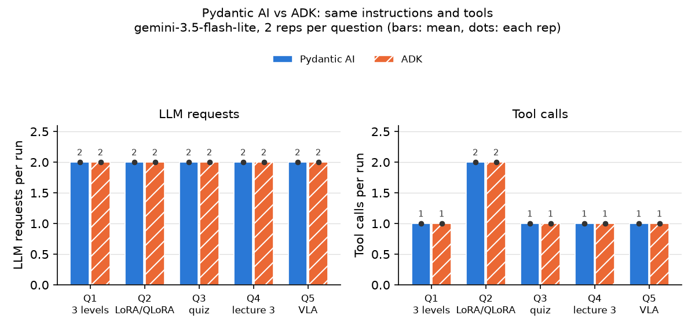
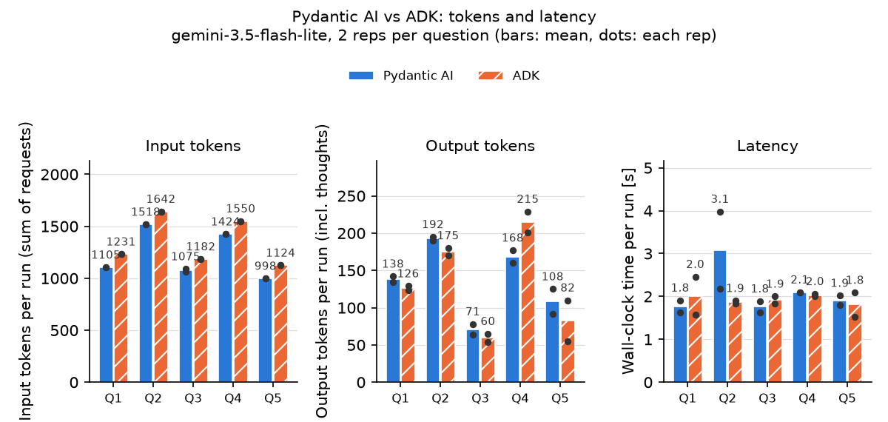

# 第3回 解答

## 演習

- 第1回（素のLLM）とエージェントの回答の違い：
  - 第1回の `app.ask`（素の LLM、同じ gemini-3.5-flash-lite）は、「3レベル」を講座の情報なしに答えた。一般的な「入門・応用・発展」の3段階を答えた回と、「AIE2026 の情報は持っていない」と断って3通りの推測を並べた回があり、どちらも中身は外れていた。
  - 第3回の `app.agent` は、用語集を `search_glossary('3レベル')` で検索してから答えた（宿題の比較で、4回とも同じ呼び出しを確認）。回答は「基礎（講義内容の確認）・実装（自分でコードを書く）・発展（調査や試行）の3段階で、どれか1つに取り組めば完了。原則として採点はしない」で、`data/glossary.json` の `homework-levels` と一致した。最後には「関連する回：第1回」が付いた。
  - 違いは、モデルの知識ではなく、答える前に講座のデータを引いたかどうかで生まれている。モデルは同じなので、正しく答えられるかどうかは、ツールと指示（「答える前に必ず search_glossary で確認する」）で決まる。

- `--trace` で見えたツール呼び出し（ツール名と引数）：
  - 「LoRAとQLoRAの違いは？」：`search_glossary({'query': 'LoRA'})` と `search_glossary({'query': 'QLoRA'})`。docstring の「query には調べたい用語を1つだけ入れる」のとおり、用語ごとに分けて検索した。
  - 「第2回の内容から確認問題を1問出して」：`make_quiz({'lecture': 2})`。ツールは第2回の用語から「QLoRA」を選んだ。
  - 1回目の実行は 503（モデルの混雑）で失敗し、20秒待って再実行したら成功した（記録は `results/exercise_20261109-115842.txt` に、失敗も含めて残した）。

- 1つの質問での LLM 呼び出し回数（`requests`）：
  - どちらの質問も `requests=2`（ツールの呼び出しを依頼 → ツールの結果を見て回答）。
  - 「LoRAとQLoRAの違いは？」は `tool_calls=2` でも `requests=2` だった。2回の検索を1回の応答でまとめて依頼していたため。互いの結果を使わない呼び出しは、まとめて呼べばリクエストが増えない（講義 Part 4 のバッチコール）。
  - トークン（入力 / 出力）は、LoRA の質問が 1,518 / 187、確認問題が 1,096 / 51。第1回の `app.ask` の入力は数十トークンだったが、エージェントでは指示文・ツールの説明・ツールの結果が毎回入るので、入力が千トークン台になる。

- 追加したツールと、docstring に書いた説明：
  - `make_quiz(lecture: int) -> str`（`app/tools.py`）。用語集から、指定した回の用語を1つ選び（`random.choice`）、`{"question": "「○○」の意味は？", "answer": <定義>, "term_id": ..., "lecture": N}` を JSON の文字列で返す。用語集にない回（第0回・第5回など）では、例外にせず「第N回の用語は用語集にありません。用意されている回: 1, 2, 3, 4, 6」と返す（`uv run pytest -q` の `lecture=0` の呼び出しで落ちないように）。
  - docstring には、使う場面（「第2回の確認問題を出して」「第3回の内容からクイズを1問出して」のように、特定の回の理解度を確かめる問題を求められたとき）、引数（回の番号を lecture に入れる）、返り値の項目、返り値の使い方（answer はそのまま見せず、利用者が答えたあとに使う）を書いた。
  - `app/agent.py` の TODO の位置で `agent.tool_plain(tools.make_quiz)` と登録した。`INSTRUCTIONS` は変えていない。`--list-tools` に make_quiz と docstring が表示され、`uv run pytest -q` は 47 件すべて passed。
  - モデルは make_quiz を1回目から呼び、答えは伏せて問題だけを出した（docstring の指示どおり）。この実行では、`INSTRUCTIONS` の「回答の最後に、関係する回（第N回）を示す」が付かなかった（宿題で、出題の応答6回のうち2回で付かないことを確認）。

## 宿題

- 取り組んだレベル：発展（a）ADK で作り直す

- 目的：
  - **何をしたかったか**：演習のエージェントと同じ指示（`INSTRUCTIONS`）と同じツール（`search_glossary`・`get_lecture_summary`・`make_quiz`）を使い、エージェントを組み立てる部分だけを Google ADK 2.x で書き直して、Pydantic AI 版と比べる。
  - **何のためか**：講義では「エージェント＝モデル＋ハーネス」で、同じモデルでもハーネスによって費用や速さが変わると学んだ。フレームワークはハーネスの一部なので、乗り換えたときに何が変わり、何が変わらないのかを、自分のエージェントで確かめておきたい。
  - **確かめたい問い**：
    1. 同じ指示とツールなら、フレームワークを変えても、ツールの選び方・引数・LLM の呼び出し回数・回答は同じになるか。
    2. 書き方（指示とツールの渡し方、モデルとキーの渡し方、実行と観測の仕方）は、どう違うか。
    3. 違いが出るとしたら、フレームワークがモデルに送るもの（コンテキスト）の何が違うのか。

- やったこと：
  - `adk_agent/glossary_agent/agent.py` と `__init__.py` を作った。`app/agent.py` の `INSTRUCTIONS` と `app/tools.py` の3つの関数をそのまま渡し、`root_agent = Agent(model=MODEL, name="glossary_agent", instruction=INSTRUCTIONS, tools=[...])` とした。`app/` は演習の make_quiz の追加以外は変えていない。ADK は `uv run --with google-adk` で一時的に足した（google-adk 2.14.0。`pyproject.toml` と `uv.lock` は変えていない）。
  - **問い1**：`scripts/compare_adk.py` で、5つの質問を両方のフレームワークに2回ずつ送った（計20回、gemini-3.5-flash-lite）。質問は、用語集にある語（Q1「3レベル」）、2語の比較（Q2 LoRA と QLoRA）、確認問題（Q3、make_quiz）、回の要点（Q4 第3回、get_lecture_summary）、用語集にない語（Q5 VLA）。質問ごとに新しいセッションで実行し、履歴は持ち越さない。1回ごとに、ツール呼び出し（名前と引数）、LLM の呼び出し回数、入出力トークン、所要時間、回答の全文を記録した。
    - LLM の呼び出し回数の数え方：Pydantic AI は `result.usage` の `requests`。ADK は、比較スクリプトの中で `root_agent` のコピーに付けた `before_model_callback` で数え、照合用に `usage_metadata` を持つイベントの数も記録した（両者は10回とも一致）。
  - **問い2**：2つの実装を並べ、書き方の違いを整理した。あわせて `adk run` で対話し（4ターン）、比較スクリプトでは見られない「同じセッションで会話を続けたとき」の動きを見た。
  - **問い3**：API を使わずに、両者が Gemini に送るリクエストを取り出して並べた（`results/request_diff.md`）。ADK は `before_model_callback` でリクエストを保存し、ダミーの応答を返して API を呼ばない。Pydantic AI は `TestModel` と、Gemini 形式への変換関数で取り出した。

- 結果：
  - **問いへの答え**
    1. ツールの選び方・引数・呼ぶ順番と、LLM の呼び出し回数（すべて2回）は、20回すべてで両者が一致した。回答の方針（用語集に従う、用語集にない語は「ない」と伝える、確認問題の答えを伏せる）も同じだった。違ったのは言い回しで、確認問題の出し方は、Pydantic AI が用語を言い換えて問いを作り（2/2）、ADK はツールの question をほぼそのまま使った（2/2）。ただし各2回なので、偶然と区別できない。
    2. 指示とツールは、どちらも「関数を渡すと docstring と型ヒントがツールの説明になる」点で同じ。違いは、モデルとキーの扱いと、実行と観測の仕方にある（下の表）。
    3. 入力トークンは ADK が1回の実行あたり 123〜126 多かった（＋8〜13%）。ADK は指示文の末尾に「You are an agent. Your internal name is "glossary_agent".」を自動で足し、ツール宣言の schema に `title` を付ける。この固定の差が、LLM の呼び出し1回ごとに約62トークンずつ乗る。

  - **書き方の違い**

    | 観点 | Pydantic AI（演習） | ADK（宿題） |
    |---|---|---|
    | 指示 | `Agent(instructions=...)` | `Agent(instruction=...)`（単数形）。`name` が必須 |
    | ツール | 作ったあとに `agent.tool_plain(fn)` で1つずつ登録 | `tools=[fn, ...]` に関数を渡す |
    | モデルとキー | `GoogleModel(MODEL, provider=GoogleProvider(api_key=...))` を実行時に渡す（テストで `TestModel` に差し替えるため） | モデル名の文字列だけ。キーは ADK の中の google-genai が環境変数から読む |
    | 実行 | `agent.run_sync(質問)` が結果のオブジェクトを返す | `Runner` とセッションを用意し、`run_async` が返すイベントの列を自分で読む |
    | 観測 | 実行後に `all_messages()` をさかのぼる（`--trace`） | 実行中にコールバック（`before_model_callback` など）で数える。`adk run` が最初から付いている |
    | 1問だけ投げるときのコード | 短い | セッション・ユーザー ID・アプリ名が必要で長い |

  - **質問ごとの比較**（各2回。LLM の呼び出しとツールの呼び出しは各回の値、トークンと時間は平均）

    | 質問 | ツール呼び出し（両者で同じ） | LLM 呼び出し | 入力トークン Pydantic AI / ADK | 出力トークン | 時間 [s] | 最後の「第N回」 |
    |---|---|---|---|---|---|---|
    | Q1 3レベル | `search_glossary('3レベル')` | 2 / 2 | 1,105 / 1,231 | 138 / 126 | 1.8 / 2.0 | 2/2・2/2 |
    | Q2 LoRA と QLoRA | `search_glossary('LoRA')`、`search_glossary('QLoRA')` | 2 / 2 | 1,518 / 1,642 | 192 / 175 | 3.1 / 1.9 | 2/2・2/2 |
    | Q3 確認問題 | `make_quiz(2)` | 2 / 2 | 1,075 / 1,182 | 71 / 60 | 1.8 / 1.9 | 2/2・2/2 |
    | Q4 第3回の内容 | `get_lecture_summary(3)` | 2 / 2 | 1,424 / 1,550 | 168 / 215 | 2.1 / 2.0 | 2/2・2/2 |
    | Q5 VLA | `search_glossary('VLA')` | 2 / 2 | 998 / 1,124 | 108 / 82 | 1.9 / 1.8 | 0/2・0/2 |

    20回すべて成功し、429・503 は出なかった。Q3 の入力トークンは、make_quiz が乱数で選ぶ用語によって変わる。Q2 の Pydantic AI の 3.1 秒は、1回（4.0 秒）に引っ張られた値。

    

    図1：LLM の呼び出し回数（左）とツールの呼び出し回数（右）。棒は2回の平均、点は各回。どの質問でも、2つのフレームワークは同じ回数だった。ツールの選び方とループの回数は、フレームワークではなく、指示と docstring とモデルで決まっている。

    

    図2：入力トークン（左）、出力トークン（中、思考を含むが今回は0）、所要時間（右）。入力は ADK がどの質問でも一定量多い。出力と時間の差は回ごとの揺れの範囲で、2回では傾向と言えない。

  - **モデルに送るものの違い**（`results/request_diff.md`、Q5 のリクエストで確認）

    | 観点 | Pydantic AI | ADK |
    |---|---|---|
    | system_instruction | `INSTRUCTIONS` そのまま（217字） | 末尾に「You are an agent. Your internal name is "glossary_agent".」を自動で追加（277字） |
    | ツール宣言 | ツールごとに1つの Tool。schema に `additionalProperties: false` | 1つの Tool に3つの宣言をまとめる。schema に `title` を6か所 |
    | その他の設定 | `function_calling_config` の mode を `VALIDATED`、`response_modalities` を TEXT | なし |
    | ツールの結果の包み方 | `{"return_value": ...}` と呼び出しの `id` | `{"result": ...}` |

    ツールの名前と説明文（docstring）は3つとも完全に一致した。system_instruction とツール宣言は、1回目と2回目のリクエストで変わらない。そのため、入力トークンの差（1回の実行あたり 123〜126）は、LLM の呼び出し1回あたり約62トークンの固定の差と読める。

  - **`adk run` で会話を続けたとき**（同じセッションで4ターン。LLM の呼び出しは計7回、ツールの呼び出しは計4回。記録は `results/adk_run_20261109-131924.txt`）
    - 「LoRAとQLoRAの違いは？」：`search_glossary('LoRA')` と `search_glossary('QLoRA')` を同時に呼び（LLM 2回）、用語集の定義に沿って答え、最後に「関係する回：第2回」。Pydantic AI 版の回答とほぼ同じ構成。
    - 「VLAとは何ですか？」：`search_glossary('VLA')`（LLM 2回）。「用語集にはない用語です」とだけ答えた。
    - 「第2回の内容から確認問題を1問出して」：`make_quiz(2)`（LLM 2回）。ツールが「事前学習」を選び、答えを伏せて「Q.『事前学習』の意味は何でしょうか？」と出題。最後の「第N回」は無し。
    - 自分の答え（「大量のデータで、ベースのモデルを作る最初の学習のことですか？」）：ツールは呼ばず（LLM 1回）、前のターンでツールが返した answer と照らして「正解です」と判定し、定義で補足した。最後に「関係する回：第2回」が付いた。

- 気づき・疑問：
  - **フレームワークを変えても、エージェントのふるまいはほとんど変わらなかった。** ツールの選び方・引数・ループの回数を決めていたのは、同じ指示・同じ docstring・同じモデルの組み合わせだった。演習の手順3で見た「動きは INSTRUCTIONS と docstring の文で決まっている」は、フレームワークをまたいでも成り立つ。逆に言えば、ふるまいを直したいときに、フレームワークを乗り換えても効果は小さい。
  - **ハーネスは、利用者に見えない指示を足す。** ADK は、エージェントの名前を名乗る1文を、指示文に自動で足していた。講義の「システムプロンプトには、ユーザーに見えない指示も入っている」は、自分で書いたエージェントでも起きていた。自分が書いていない文が毎回コンテキストに入り、1回あたり約62トークン（今回は＋8〜13%）、LLM を呼ぶたびに費用が乗る。ループが長いエージェントでは、回数に比例して効く。
  - **確認のしかたが違うと、作りやすいテストが違う。** Pydantic AI は `TestModel` でモデルを丸ごと差し替えてテストする作り。ADK は `before_model_callback` でリクエストを横取りし、ダミーの応答を返せる。今回はこれを使って、API を使わずに、実際に送られるはずのリクエストを取り出せた。モデルの直前に差し込める口は、記録・権限の確認・停止（講義 Part 7・9）にも使える。
  - **末尾に付ける指示は、確率的に落ちる。** 確認問題を出す応答では、「回答の最後に、関係する回（第N回）を示す」が6回中2回（演習の1回と `adk run` の1回）付かなかった。どちらも、問題を出して利用者の返事を待つ形の応答だった。用語集にない Q5 では、4回とも付かなかった（関係する回が無いので、書きようがない。Pydantic AI は「関係する回：用語集未登録」と欄だけ書いた回があった）。必ず付けたいなら、指示に頼らず、ハーネス側で付けるか、構造化出力にするほうが確実だと思う。
  - **「推測で断定せず『用語集にはない』と伝える」の解釈が、回によって揺れた。** Q5 では4回とも「用語集にない」と答えたが、そのうち2回（両フレームワークで1回ずつ）は「一般的には Vision-Language-Action を指すことがある」と、用語集の外の知識を付け足した。断定はしていないので指示違反ではないが、「用語集の外の知識を出してよいか」を指示に書いていないことが揺れの原因だと思う。
  - **会話の履歴の扱いで、できることが変わる。** 比較スクリプトでは質問ごとにセッションを作り直したので、確認問題の出題までしか見られなかった。`adk run` は同じセッションで会話を続けるので、次のターンでツールの answer を使って採点まで進んだ。make_quiz の docstring に書いた「answer は利用者が答えたあとに使う」は、履歴があって初めて意味を持つ。
  - **`adk run` は、会話を手元のファイルに保存する。** `adk run` は、入力・ツールの呼び出しと返り値・回答を `adk_agent/glossary_agent/.adk/session.db`（SQLite）に記録していた。ログには送受信の事実しか残らないので、今回の記録はこの DB から取り出した。便利な一方で、会話の中身がリポジトリの中に残るので、提出からは外した。講義 Part 6・9 の「メモリに何が入ったかを人が確かめる」は、こうした保存先にも当てはまる。
  - その他：比較スクリプトでは、ADK の実行ごとに `asyncio.run()` を作り直していたため、終了時に google-genai の非同期クライアントが「Event loop is closed」という警告を出した（計測には影響なく、終了コードは0）。Pydantic AI の `output_tokens` には Gemini の思考トークンが含まれる（今回の lite では0）。ADK 2.14 の `retry_config` は既定で None なので、ADK が裏で再試行して呼び出し回数が増えることはない。
  - 疑問：
    1. 約62トークンの内訳（名乗りの1文と `title` がそれぞれ何トークンか）は推測にとどまる。`count_tokens` に両方のリクエストを渡せば測れる。
    2. 確認問題の出し方の違い（言い換える／そのまま使う）が、ADK が足す1文や schema の違いによるものか、偶然かは、回数を増やして確かめないと分からない。ADK の名乗りの1文は、設定で消せるのかも調べたい。
