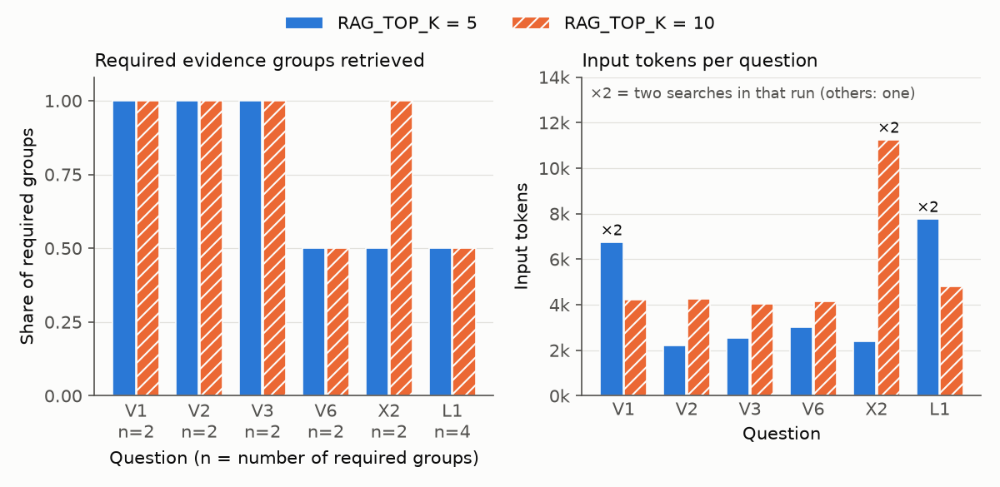
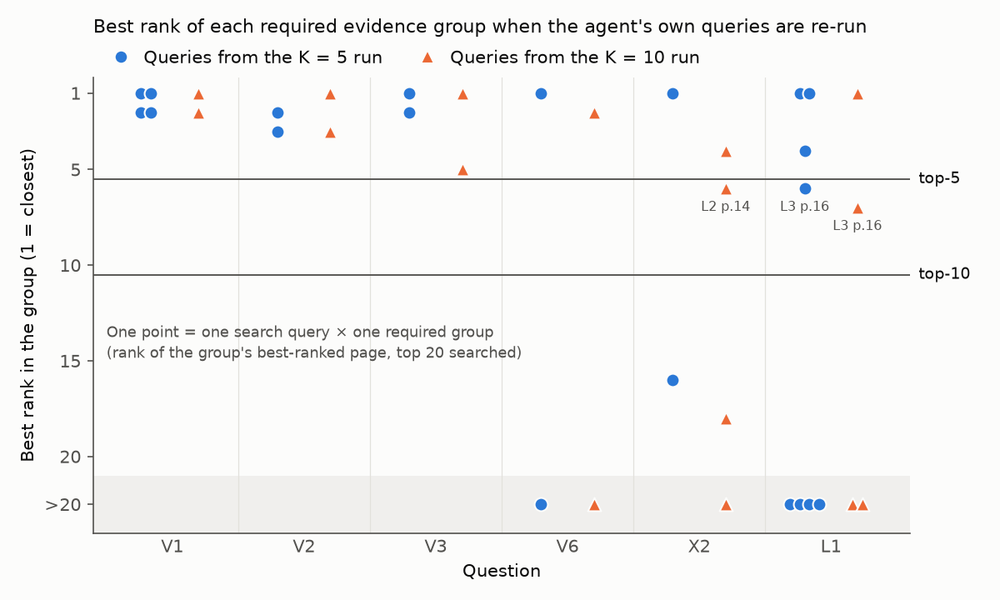

# 第5回 解答

## 演習

- 回答モデル（実行時の`[model]`）：gemini-3.5-flash-lite
- 比較した質問：第2回の説明では、LoRAは何を固定し何を学習しますか？ QLoRAは何を加えますか？
- 対象資料：全文投入は全9資料・438ページ、ほかの3方式は第1〜3回の本講義・214ページ（範囲が違うので、方式の優劣の比較にはならない）

### 各方式の結果

| 方式 | 回答の要点・正しさ | 引用ページと根拠 | 時間（秒） | 入力／出力トークン数 | モデル応答回数 | 生成API推定費用（USD） |
|---|---|---|---|---|---|---|
| 全文投入 | 正答（元の重みを固定し低ランクの差分だけ学習、QLoRA は 4bit に圧縮）。ただし「答えはそのままお伝えできませんが」と前置き | 第2回 p.51、p.52 | 10.00 | 117,025 / 273 | 1 | 0.035790 |
| ベクトル検索 | 正答 | 第2回 p.51、p.52 | 7.65 | 3,027 / 153 | 2 | 0.001291 |
| Tree | 正答（「QLOAR」という誤記が1か所） | 第2回 p.52 | 29.70 | 9,214 / 313 | 5 | 0.003547 |
| Graph | 正答 | 第2回 p.51、p.52 | 11.32 | 5,776 / 214 | 2 | 0.002268 |

時間はどれも1回だけの計測（503 が多く、ベクトル検索と Graph はやり直して成功）。

- 検索だけを実行して見つかったページと、その本文で確認できたこと：上位5件は第2回 p.52、p.51、p.60、p.47、p.61。答えを支える p.52 と p.51 が1・2位で、残りは用語が似ているだけのページ。
- `--trace`で見えたツール呼び出し：ベクトル検索と Graph は検索1回。Tree は `browse_tree` を4回（講義一覧 → 第2回 → 章 → p.52）呼び、全文を読んだのは p.52 だけ。
- 取得した情報が足りなかった例、取得できたのに回答へ使えなかった例：この質問は p.52 だけで答えがそろうので、4方式とも同じ答えになり、差は出なかった。
- 今回の用途に採用したい方式と、その理由・比較条件の限界：ベクトル検索。全文投入は入力が約39倍、費用が約28倍で、答えは同じだった。ただし1問1回ずつなので、方式の優劣は決められない。
- 気づき・疑問：Tree の候補に付く「先頭文」は、多くのページで見出しと同じ文字列か章の表示だった（第3回は71ページ中62ページ）。モデルは実質的に見出しだけでページを選んでいる。

## 宿題

- 取り組んだレベル：**基礎**（`app/config.py` の `RAG_TOP_K` を 5 → 10 に変更）

### 目的

ベクトル検索が返すページの数を増やすと、何が良くなり何が増えるかを確かめる。

1. 必須の根拠ページを取れる割合は上がるか
2. 回答は正しくなるか（取得と利用を分けて見る）
3. 入力トークン・費用はどれだけ増えるか
4. 件数を増やしても解けない質問はどれか

### やったこと

1. **評価の質問を作り直した。** スライドの語をそのまま使った質問では、上位5件で必須の根拠がほぼ取れて（取得率 0.97）差が出なかった。そこで、言い換え・列挙・回をまたぐ質問を作り、埋め込みの検索順位で差が出る6問を選んだ（`lectures/05/eval/questions.json`）。
2. **同じ6問を K=5 と K=10 で1回ずつ実行した**（`scripts/eval_topk.py`、モデルは既定の gemini-3.5-flash-lite）。検索語・取得ページ・引用・トークン・費用を記録し、trace は `results/trace/` に保存した。
3. **検索語を固定して K の効果だけを取り出した。** エージェントは毎回検索語を変えるので、両方の本番で使われた検索語15個を検索し直し、必須ページの順位を記録した（`scripts/replay_queries.py`）。
4. **回答の正しさを、質問ごとの要点で判定した**（`results/labels.csv`）。判定は Claude が下書きし、12件すべてを自分で読んで確認した。

### 結果

1. **件数を増やしても、根拠はほとんど増えなかった。** 取得率は 0.75 → 0.83 で、上がったのは X2 だけ。同じ検索語で K だけを変えると、K=5 の本番の検索語では1問も変わらなかった。
2. **回答の正しさも上がらなかった。** 正答は K=5 で 3/6、K=10 で 2/6（残りは一部正答、誤答なし）。X2 は K=10 で根拠を取得したのに、回答で使わなかった。
3. **入力トークンは中央値で約1.5倍、費用は約1.2倍に増えた。**
4. **件数では届かない根拠があった。** V6 の p.53、L1 の p.41・p.31 は、どの検索語でも21位以下だった。

| 質問 | ねらい | 必須の取得率 K=5 → K=10 | 入力トークン K=5 → K=10 | 回答の正しさ K=5 → K=10 |
|---|---|---|---|---|
| V1 メールが2通届く | 対照 | 1.00 → 1.00 | 6,747 → 4,224 | 正答 → 一部正答 |
| V2 新しいチャットでも覚えさせる | 言い換え | 1.00 → 1.00 | 2,208 → 4,242 | 正答 → 正答 |
| V3 答えが毎回ちがう | 言い換え | 1.00 → 1.00 | 2,523 → 4,030 | 正答 → 正答 |
| V6 フォルダを消された | 言い換え | 0.50 → 0.50 | 3,029 → 4,143 | 一部正答 → 一部正答 |
| X2 第2回の性質と第3回の設計 | 回をまたぐ | 0.50 → 1.00 | 2,394 → 11,248 | 一部正答 → 一部正答 |
| L1 費用を下げる工夫 | 列挙 | 0.50 → 0.50 | 7,765 → 4,810 | 一部正答 → 一部正答 |
| 平均・合計 | | 0.75 → 0.83 | 4,111 → 5,450 | 正答 3/6 → 2/6 |

図1　左は必須の根拠の取得率、右は入力トークン数（青が K=5、橙の斜線が K=10、×2 は検索を2回した実行）。取得率が上がったのは X2 だけで、その X2 は入力が約4.7倍になった。

図2　本番の検索語で検索し直したときの、必須の根拠ページの順位。K=10 で新しく入るのは top-5 と top-10 の線のあいだの3点だけで、20位より下の点も残る。

### 気づき・疑問

- **件数より、検索の分け方が効いた。** L1 は K=5 でも、2回目の検索「プロンプトキャッシュ」で根拠を1位で取れた。X2 も、回ごとに分けた検索語で初めて取れた。件数を増やすより、検索を分けるよう指示文を変えるほうが効くと考える。
- **取れることと、使われることは別。** 根拠がそろった回はほぼ正答だったが、X2 は取得した根拠を使わず、入力だけが約4.7倍になった。誤りは作り話ではなく、取れなかった要点の書き漏れとして出た。
- **評価セットが簡単だと差が出ない。** スライドの語のままの質問では、件数を変えても差が見えなかった。
- 疑問：1問1回ずつなので、V1 の「正答 → 一部正答」のような差が K の効果か回答の揺れかは区別できない。複数回の実行で確かめたい。
